# Hệ thống luyện thi trực tuyến – Trường THPT

Trang web: <https://trangtu66.github.io/Taode_thi_online/> · Cổng toàn trường: <https://trangtu66.github.io/Taode_thi_online/luyen_thi.html>

Kho gồm hai phần: **trang web** (thư mục gốc) và **kho học liệu theo môn** (`mon/`).

## 1. Kho học liệu theo môn – `mon/<môn>/`

Môn nào cũng có đúng các ngăn như môn Toán:

```
mon/
├── toan/                 Môn Toán (Tổ Toán)
│   ├── khbd/             Kế hoạch bài dạy (Word)      lop10/ lop11/ lop12/
│   ├── slide/            Bài giảng PowerPoint           lop10/ lop11/ lop12/
│   ├── trac_nghiem/      Đề trực tuyến: nguồn JSON + đề Word có đáp án, lời giải   lop10/ lop11/ lop12/
│   └── ma_tran/          Ma trận, bản đặc tả đề luyện tập / kiểm tra
├── ngu_van/              Môn Ngữ văn (bản demo)
├── hoa_hoc/  sinh_hoc/  lich_su/  dia_li/  gdkt_pl/  tieng_anh/   (bản demo: bài củng cố lớp 10)
│   └── mỗi môn: khbd/  slide/  trac_nghiem/  ma_tran/
└── vat_li/               Môn Vật lí (đang xây dựng)
```

Mã môn dùng trong tên thư mục: `toan`, `ngu_van`, `vat_li`, `hoa_hoc`, `sinh_hoc`, `lich_su`, `dia_li`, `gdkt_pl`, `tin_hoc`, `cong_nghe`, `tieng_anh`.

Quy ước tên file: `KHBD_<MÔN><Khối>_<TênBài>_T<Tiết>.docx`, `Slide_<MÔN><Khối>_<TênBài>_T<Tiết>.pptx`
(ví dụ `KHBD_TOAN11_Bai7_T15-16.docx`, `Slide_TOAN11_Bai7_T15-16.pptx`).

## 2. Trang web – thư mục gốc (KHÔNG di chuyển)

Mã QR in trên slide, KHBD và các link đã gửi học sinh trỏ thẳng vào những file này, nên chúng phải nằm yên ở gốc:

| File | Vai trò |
|---|---|
| `index.html` | Trang chủ môn Toán (chuyển link `#e=` sang `lam_bai.html` – giữ nguyên đoạn này) |
| `luyen_thi.html` | Cổng luyện thi toàn trường: chọn môn |
| `luyen_tap.html` | Luyện tập Toán theo bài, chương, định kỳ, tốt nghiệp |
| `lam_bai.html` | Trang làm bài và chấm điểm (dùng chung mọi môn) |
| `quan_ly.html`, `ket_qua.html`, `xep_hang.html` | Quản lí bài, kết quả, xếp hạng |
| `cau_hinh.js` | Danh sách bài + địa chỉ nhận kết quả |
| `de_luyen_tap.js`, `van_demo.js`, `mon_demo.js` | Danh mục đề hiển thị trên cổng |
| `cc_*.html` | Bài củng cố cuối tiết (Toán) – đích của mã QR |
| `lt_*`, `oc_*`, `dk_*`, `tn_*.html` | Đề luyện tập 3 dạng, ôn chương, định kỳ, tốt nghiệp (Toán) |
| `van_*.html` | Bài trực tuyến môn Ngữ văn |
| `hoa_*`, `sinh_*`, `su_*`, `dia_*`, `gdkt_*`, `anh_*.html` | Bài trực tuyến Hóa, Sinh, Sử, Địa, GDKT&PL, Tiếng Anh |
| `*.png`, `hinh_de/` | Ảnh minh hoạ trong đề (các trang làm bài đang dùng) |

Trang làm bài của môn mới đặt tên theo mẫu `<mã môn>_<loại>_<bài>_k<khối>.html`, ví dụ `ly_cc_bai1_k10.html`.

## 3. Không đưa lên kho

`NHAN_KET_QUA/` (mã giáo viên, mã Apps Script) và đề kiểm tra chính thức trước giờ thi.

---

## 4. Sơ đồ tư duy bài học

> Chuẩn màu: 🔵 tiêu đề gốc `#1E40AF` · nhánh tím `#7C3AED` · xanh lá `#065F46` · đỏ `#B91C1C` · cam `#B45309` · lá sáng `#EDE9FE / #D1FAE5 / #FEE2E2 / #FEF3C7`

---

## 🗺️ Sơ đồ tư duy tổng quan – Toán 10 Học kì I

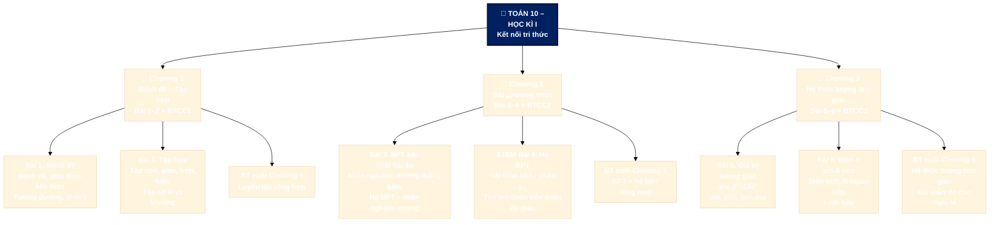

---

## 🗺️ Sơ đồ tư duy tổng quan – Toán 11 Học kì I

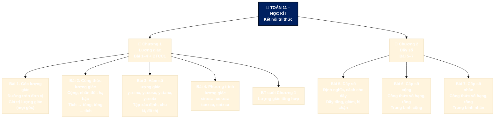

---

## 🗺️ Sơ đồ tư duy tổng quan – Toán 12 Học kì I

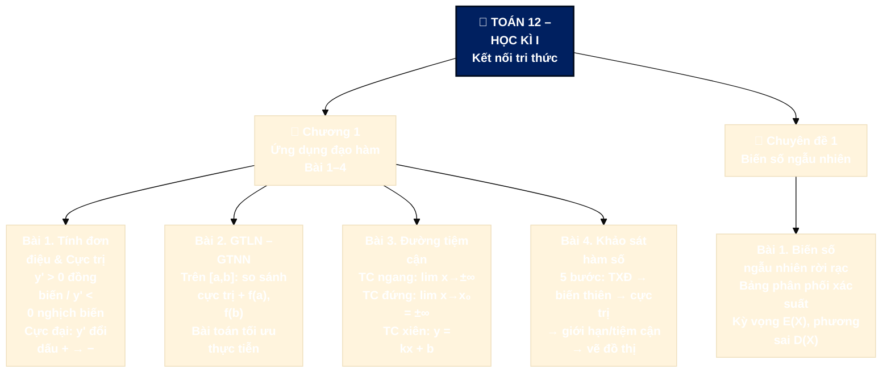

---

## 🗺️ Sơ đồ tư duy tổng quan – Vật lí 12 Học kì I

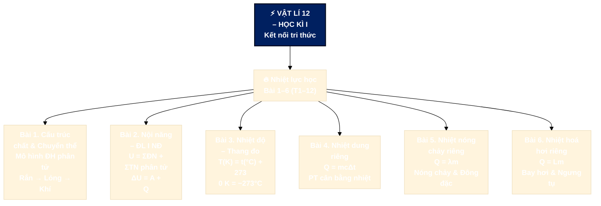

---

## 📌 Sơ đồ tư duy từng bài – Toán 10

### Toán 10 – Bài 1. Mệnh đề *(Tiết 1–4)*

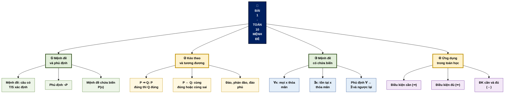

> **Bài củng cố:** <https://trangtu66.github.io/Taode_thi_online/cc_bai1_t10.html>

---

### Toán 10 – Bài 2. Tập hợp *(Tiết 5–9)*

```mermaid
%%{init: {"theme": "base", "htmlLabels": true, "flowchart": {"htmlLabels": true, "padding": 10, "curve": "basis"}, "themeVariables": {"fontSize": "15px"}}}%%
graph TD
    G["🎯<BR/>BÀI<BR/>2<BR/>·<BR/>TOÁN<BR/>10<BR/>TẬP<BR/>HỢP"]:::root
    G --> A["① Khái niệm<br/>tập hợp"]:::n1
    G --> B["② Tập con &<br/>tập hợp bằng nhau"]:::n2
    G --> C["③ Phép toán<br/>tập hợp"]:::n3
    G --> D["④ Tập số R<br/>và khoảng"]:::n4

    A --> A1["Phần tử thuộc ∈<br/>/ không thuộc ∉"]:::l1
    A --> A2["Tập rỗng ∅"]:::l1
    A --> A3["Biểu đồ Venn"]:::l1

    B --> B1["A ⊂ B: mọi<br/>x∈A thì x∈B"]:::l2
    B --> B2["A = B ⟺<br/>A⊂B và B⊂A"]:::l2
    B --> B3["Số tập con của<br/>A: 2ⁿ (|A|=n)"]:::l2

    C --> C1["A ∩ B: phần<br/>tử thuộc cả hai"]:::l3
    C --> C2["A ∪ B: thuộc<br/>ít nhất một"]:::l3
    C --> C3["A \ B: thuộc<br/>A không thuộc B"]:::l3
    C --> C4["Cᵤ(A): bù của A<br/>trong U"]:::l3

    D --> D1["(a;b), [a;b], (a;b], [a;b)"]:::l4
    D --> D2["(a;+∞), (−∞;b)"]:::l4
    D --> D3["Giao, hợp khoảng"]:::l4

    classDef root fill:#002060,color:#FFFFFF,stroke:#000B1E,stroke-width:2px,font-weight:bold
    classDef n1 fill:#E2EFDA,color:#000000,stroke:#375623,stroke-width:3px,font-weight:bold
    classDef n2 fill:#FFF2CC,color:#000000,stroke:#BF8F00,stroke-width:3px,font-weight:bold
    classDef n3 fill:#E2EFDA,color:#000000,stroke:#375623,stroke-width:3px,font-weight:bold
    classDef n4 fill:#FFF2CC,color:#000000,stroke:#BF8F00,stroke-width:3px,font-weight:bold
    classDef n5 fill:#E2EFDA,color:#000000,stroke:#375623,stroke-width:3px,font-weight:bold
    classDef l1 fill:#EDF5E8,color:#000000,stroke:#548235
    classDef l2 fill:#FFF8E1,color:#000000,stroke:#BF8F00
    classDef l3 fill:#E3EEF9,color:#000000,stroke:#2F5597
    classDef l4 fill:#F3E8F7,color:#000000,stroke:#7030A0
    classDef l5 fill:#FDE9E1,color:#000000,stroke:#C55A11
```

> **Bài củng cố:** <https://trangtu66.github.io/Taode_thi_online/cc_bai2_t10.html>

---

### Toán 10 – Bài 3. BPT bậc nhất hai ẩn *(Tiết 10–13)*

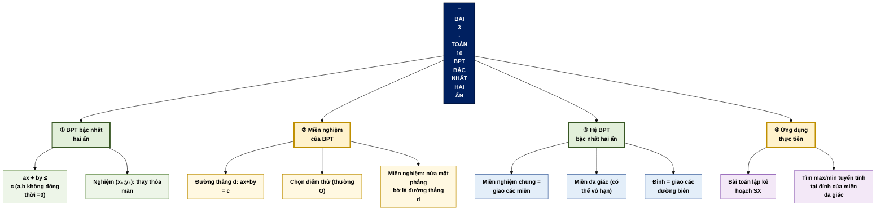

> **Bài củng cố:** <https://trangtu66.github.io/Taode_thi_online/cc_bai3_t10.html>

---

### Toán 10 – STEM Bài 4. Hệ BPT & Khẩu phần ăn *(Tiết 14)*

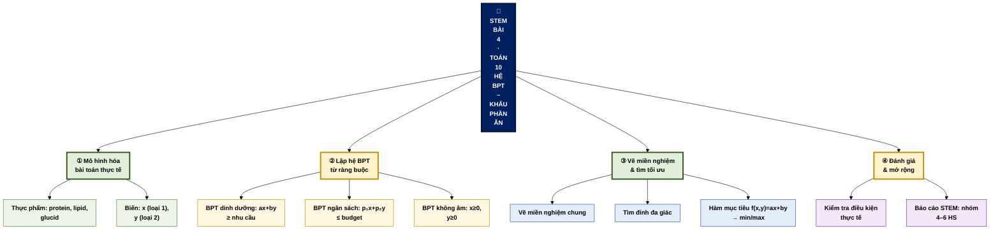

---

### Toán 10 – Bài 5. Giá trị lượng giác của góc từ 0° đến 180° *(Tiết 16–17)*

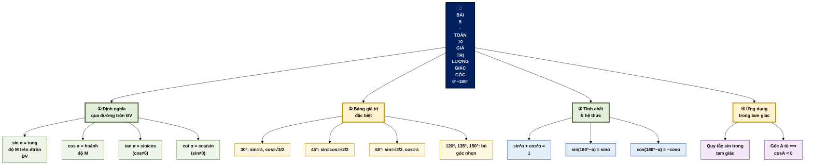

> **Bài củng cố:** <https://trangtu66.github.io/Taode_thi_online/cc_bai5_t10.html>

---

### Toán 10 – Bài 6. Định lí sin, cos & Diện tích tam giác *(Tiết 18–21)*

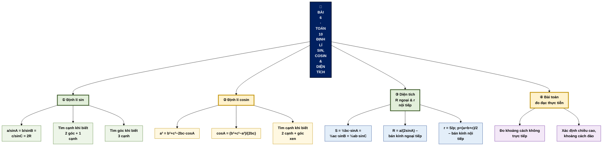

> **Bài củng cố:** <https://trangtu66.github.io/Taode_thi_online/cc_bai6_t10.html>

---

### Toán 10 – Bài tập cuối Chương III. Hệ thức lượng trong tam giác *(Tiết 22)*

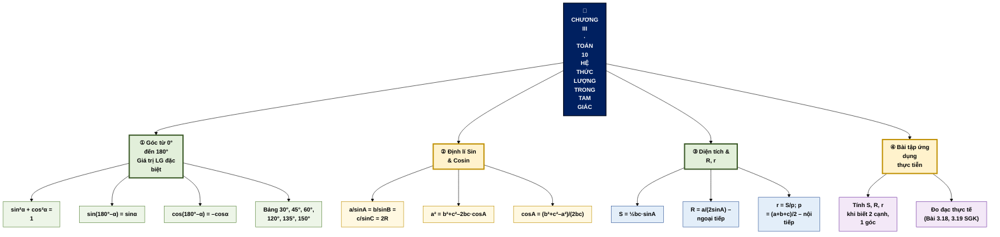

> **Bài củng cố:** <https://trangtu66.github.io/Taode_thi_online/cc_chuong3_t10.html>

---

### Toán 10 – Bài 7. Các khái niệm mở đầu *(Tiết 26–27)*

```mermaid
%%{init: {"theme": "base", "htmlLabels": true, "flowchart": {"htmlLabels": true, "padding": 10, "curve": "basis"}, "themeVariables": {"fontSize": "15px"}}}%%
graph TD
    G["🎯<br/>BÀI 7<br/>Các khái niệm<br/>mở đầu"]:::root
    G --> A["① Vectơ"]:::n1
    G --> B["② Cùng phương"]:::n2
    G --> C["③ Cùng hướng – bằng nhau"]:::n3
    G --> D["④ Vectơ-không"]:::n4

    A --> A1["★ Đoạn thẳng có hướng"]:::l1
    A --> A2["Kí hiệu AB→, a→"]:::l1
    A --> A3["★ Độ dài |AB→| = AB"]:::l1
    A --> A4["Biểu diễn lực, vận tốc"]:::l1

    B --> B1["Giá của vectơ"]:::l2
    B --> B2["★ Giá song song hoặc trùng nhau"]:::l2
    B --> B3["A, B, C thẳng hàng ⇔ AB→, AC→ cùng phương"]:::l2

    C --> C1["Cùng phương thì cùng hoặc ngược hướng"]:::l3
    C --> C2["★ a→ = b→: cùng độ dài, cùng hướng"]:::l3
    C --> C3["Mỗi O, a→: duy nhất A với OA→ = a→"]:::l3

    D --> D1["AA→, BB→ = 0→"]:::l4
    D --> D2["★ Độ dài 0"]:::l4
    D --> D3["Cùng hướng với mọi vectơ"]:::l4

    classDef root fill:#002060,color:#FFFFFF,stroke:#000B1E,stroke-width:2px,font-weight:bold
    classDef n1 fill:#E2EFDA,color:#000000,stroke:#375623,stroke-width:3px,font-weight:bold
    classDef n2 fill:#FFF2CC,color:#000000,stroke:#BF8F00,stroke-width:3px,font-weight:bold
    classDef n3 fill:#E2EFDA,color:#000000,stroke:#375623,stroke-width:3px,font-weight:bold
    classDef n4 fill:#FFF2CC,color:#000000,stroke:#BF8F00,stroke-width:3px,font-weight:bold
    classDef n5 fill:#E2EFDA,color:#000000,stroke:#375623,stroke-width:3px,font-weight:bold
    classDef l1 fill:#EDF5E8,color:#000000,stroke:#548235
    classDef l2 fill:#FFF8E1,color:#000000,stroke:#BF8F00
    classDef l3 fill:#E3EEF9,color:#000000,stroke:#2F5597
    classDef l4 fill:#F3E8F7,color:#000000,stroke:#7030A0
    classDef l5 fill:#FDE9E1,color:#000000,stroke:#C55A11
```

> **Bài củng cố:** <https://trangtu66.github.io/Taode_thi_online/cc_bai7_t10.html>

---

### Toán 10 – Bài 8. Tổng và hiệu của hai vectơ *(Tiết 28–29)*

```mermaid
%%{init: {"theme": "base", "htmlLabels": true, "flowchart": {"htmlLabels": true, "padding": 10, "curve": "basis"}, "themeVariables": {"fontSize": "15px"}}}%%
graph TD
    G["🎯<br/>BÀI 8<br/>Tổng và hiệu<br/>của hai vectơ"]:::root
    G --> A["① Tổng hai vectơ"]:::n1
    G --> B["② Hiệu hai vectơ"]:::n2
    G --> C["③ Trung điểm – trọng tâm"]:::n3
    G --> D["④ Ứng dụng"]:::n4

    A --> A1["★ Quy tắc ba điểm: AB→ + BC→ = AC→"]:::l1
    A --> A2["★ Quy tắc hình bình hành: AB→ + AD→ = AC→"]:::l1
    A --> A3["Giao hoán, kết hợp"]:::l1
    A --> A4["a→ + 0→ = a→"]:::l1

    B --> B1["Vectơ đối −a→"]:::l2
    B --> B2["a→ − b→ = a→ + (−b→)"]:::l2
    B --> B3["★ Quy tắc hiệu: MN→ = ON→ − OM→"]:::l2

    C --> C1["★ I trung điểm AB: IA→ + IB→ = 0→"]:::l3
    C --> C2["★ G trọng tâm: GA→ + GB→ + GC→ = 0→"]:::l3

    D --> D1["Tổng hợp lực"]:::l4
    D --> D2["Tổng hợp vận tốc"]:::l4
    D --> D3["Tàu qua sông nhanh nhất"]:::l4
    D --> D4["Kéo pháo lên dốc"]:::l4

    classDef root fill:#002060,color:#FFFFFF,stroke:#000B1E,stroke-width:2px,font-weight:bold
    classDef n1 fill:#E2EFDA,color:#000000,stroke:#375623,stroke-width:3px,font-weight:bold
    classDef n2 fill:#FFF2CC,color:#000000,stroke:#BF8F00,stroke-width:3px,font-weight:bold
    classDef n3 fill:#E2EFDA,color:#000000,stroke:#375623,stroke-width:3px,font-weight:bold
    classDef n4 fill:#FFF2CC,color:#000000,stroke:#BF8F00,stroke-width:3px,font-weight:bold
    classDef n5 fill:#E2EFDA,color:#000000,stroke:#375623,stroke-width:3px,font-weight:bold
    classDef l1 fill:#EDF5E8,color:#000000,stroke:#548235
    classDef l2 fill:#FFF8E1,color:#000000,stroke:#BF8F00
    classDef l3 fill:#E3EEF9,color:#000000,stroke:#2F5597
    classDef l4 fill:#F3E8F7,color:#000000,stroke:#7030A0
    classDef l5 fill:#FDE9E1,color:#000000,stroke:#C55A11
```

> **Bài củng cố:** <https://trangtu66.github.io/Taode_thi_online/cc_bai8_t10.html>

---

### Toán 10 – Bài 9. Tích của một vectơ với một số *(Tiết 30–31)*

```mermaid
%%{init: {"theme": "base", "htmlLabels": true, "flowchart": {"htmlLabels": true, "padding": 10, "curve": "basis"}, "themeVariables": {"fontSize": "15px"}}}%%
graph TD
    G["🎯<br/>BÀI 9<br/>Tích của một vectơ<br/>với một số"]:::root
    G --> A["① Định nghĩa k·a→"]:::n1
    G --> B["② Tính chất"]:::n2
    G --> C["③ Cùng phương – phân tích"]:::n3
    G --> D["④ Trung điểm – trọng tâm – khối tâm"]:::n4

    A --> A1["★ k > 0: cùng hướng a→"]:::l1
    A --> A2["★ k < 0: ngược hướng a→"]:::l1
    A --> A3["★ |k·a→| = |k|·|a→|"]:::l1
    A --> A4["k·a→ = 0→ khi k = 0 hoặc a→ = 0→"]:::l1

    B --> B1["k(t·a→) = (kt)·a→"]:::l2
    B --> B2["(k + t)·a→ = k·a→ + t·a→"]:::l2
    B --> B3["k(a→ ± b→) = k·a→ ± k·b→"]:::l2
    B --> B4["1·a→ = a→; (−1)·a→ = −a→"]:::l2

    C --> C1["★ a→, b→ cùng phương ⇔ a→ = k·b→"]:::l3
    C --> C2["A, B, C thẳng hàng ⇔ AC→ = t·AB→"]:::l3
    C --> C3["★ u→ = x·a→ + y·b→ (duy nhất)"]:::l3

    D --> D1["★ OA→ + OB→ = 2·OI→"]:::l4
    D --> D2["★ OA→ + OB→ + OC→ = 3·OG→"]:::l4
    D --> D3["Khối tâm: Σ mᵢ·MAᵢ→ = 0→"]:::l4

    classDef root fill:#002060,color:#FFFFFF,stroke:#000B1E,stroke-width:2px,font-weight:bold
    classDef n1 fill:#E2EFDA,color:#000000,stroke:#375623,stroke-width:3px,font-weight:bold
    classDef n2 fill:#FFF2CC,color:#000000,stroke:#BF8F00,stroke-width:3px,font-weight:bold
    classDef n3 fill:#E2EFDA,color:#000000,stroke:#375623,stroke-width:3px,font-weight:bold
    classDef n4 fill:#FFF2CC,color:#000000,stroke:#BF8F00,stroke-width:3px,font-weight:bold
    classDef n5 fill:#E2EFDA,color:#000000,stroke:#375623,stroke-width:3px,font-weight:bold
    classDef l1 fill:#EDF5E8,color:#000000,stroke:#548235
    classDef l2 fill:#FFF8E1,color:#000000,stroke:#BF8F00
    classDef l3 fill:#E3EEF9,color:#000000,stroke:#2F5597
    classDef l4 fill:#F3E8F7,color:#000000,stroke:#7030A0
    classDef l5 fill:#FDE9E1,color:#000000,stroke:#C55A11
```

> **Bài củng cố:** <https://trangtu66.github.io/Taode_thi_online/cc_bai9_t10.html>

---

### Toán 10 – Bài 10. Vectơ trong mặt phẳng toạ độ *(Tiết 32–34)*

```mermaid
%%{init: {"theme": "base", "htmlLabels": true, "flowchart": {"htmlLabels": true, "padding": 10, "curve": "basis"}, "themeVariables": {"fontSize": "15px"}}}%%
graph TD
    G["🎯<br/>BÀI 10<br/>Vectơ trong mặt<br/>phẳng toạ độ"]:::root
    G --> A["① Toạ độ của vectơ"]:::n1
    G --> B["② Phép toán theo toạ độ"]:::n2
    G --> C["③ Điểm – độ dài"]:::n3
    G --> D["④ Trung điểm – trọng tâm – ứng dụng"]:::n4

    A --> A1["Hệ trục Oxy, vectơ đơn vị i→, j→"]:::l1
    A --> A2["★ u→ = x·i→ + y·j→ ⇔ u→ = (x; y)"]:::l1
    A --> A3["Hai vectơ bằng nhau ⇔ cùng toạ độ"]:::l1

    B --> B1["★ u→ ± v→ = (x ± x'; y ± y')"]:::l2
    B --> B2["★ k·u→ = (kx; ky)"]:::l2
    B --> B3["Cùng phương: x' = kx, y' = ky"]:::l2

    C --> C1["★ OM→ = (x; y), |OM→| = √(x² + y²)"]:::l3
    C --> C2["★ MN→ = (x' − x; y' − y)"]:::l3
    C --> C3["MN = √((x' − x)² + (y' − y)²)"]:::l3

    D --> D1["★ Trung điểm ((x_A + x_B)/2; (y_A + y_B)/2)"]:::l4
    D --> D2["★ Trọng tâm: trung bình cộng 3 đỉnh"]:::l4
    D --> D3["Dự báo vị trí tâm bão"]:::l4
    D --> D4["Chuyển động tàu thuỷ, quân mã"]:::l4

    classDef root fill:#002060,color:#FFFFFF,stroke:#000B1E,stroke-width:2px,font-weight:bold
    classDef n1 fill:#E2EFDA,color:#000000,stroke:#375623,stroke-width:3px,font-weight:bold
    classDef n2 fill:#FFF2CC,color:#000000,stroke:#BF8F00,stroke-width:3px,font-weight:bold
    classDef n3 fill:#E2EFDA,color:#000000,stroke:#375623,stroke-width:3px,font-weight:bold
    classDef n4 fill:#FFF2CC,color:#000000,stroke:#BF8F00,stroke-width:3px,font-weight:bold
    classDef n5 fill:#E2EFDA,color:#000000,stroke:#375623,stroke-width:3px,font-weight:bold
    classDef l1 fill:#EDF5E8,color:#000000,stroke:#548235
    classDef l2 fill:#FFF8E1,color:#000000,stroke:#BF8F00
    classDef l3 fill:#E3EEF9,color:#000000,stroke:#2F5597
    classDef l4 fill:#F3E8F7,color:#000000,stroke:#7030A0
    classDef l5 fill:#FDE9E1,color:#000000,stroke:#C55A11
```

> **Bài củng cố:** <https://trangtu66.github.io/Taode_thi_online/cc_bai10_t10.html>

---

### Toán 10 – Bài 11. Tích vô hướng của hai vectơ *(Tiết 35–37)*

```mermaid
%%{init: {"theme": "base", "htmlLabels": true, "flowchart": {"htmlLabels": true, "padding": 10, "curve": "basis"}, "themeVariables": {"fontSize": "15px"}}}%%
graph TD
    G["🎯<br/>BÀI 11<br/>Tích vô hướng<br/>của hai vectơ"]:::root
    G --> A["① Góc giữa hai vectơ"]:::n1
    G --> B["② Tích vô hướng"]:::n2
    G --> C["③ Biểu thức toạ độ"]:::n3
    G --> D["④ Tính chất – ứng dụng"]:::n4

    A --> A1["Vẽ chung gốc: (u→, v→) = góc BAC"]:::l1
    A --> A2["Từ 0° đến 180°"]:::l1
    A --> A3["★ 0°: cùng hướng; 180°: ngược hướng"]:::l1
    A --> A4["u→ ⊥ v→ ⇔ góc 90°"]:::l1

    B --> B1["★ u→·v→ = |u→|·|v→|·cos(u→, v→)"]:::l2
    B --> B2["★ u→ ⊥ v→ ⇔ u→·v→ = 0"]:::l2
    B --> B3["u→² = |u→|²"]:::l2
    B --> B4["Công A = F→·MN→"]:::l2

    C --> C1["★ u→·v→ = xx' + yy'"]:::l3
    C --> C2["★ cos(u→, v→) = (xx' + yy') / (|u→|·|v→|)"]:::l3
    C --> C3["Vuông góc: xx' + yy' = 0"]:::l3

    D --> D1["Giao hoán, phân phối"]:::l4
    D --> D2["(u→ ± v→)² = u→² ± 2u→·v→ + v→²"]:::l4
    D --> D3["Trực tâm, giải tam giác"]:::l4
    D --> D4["Công của lực thành phần"]:::l4

    classDef root fill:#002060,color:#FFFFFF,stroke:#000B1E,stroke-width:2px,font-weight:bold
    classDef n1 fill:#E2EFDA,color:#000000,stroke:#375623,stroke-width:3px,font-weight:bold
    classDef n2 fill:#FFF2CC,color:#000000,stroke:#BF8F00,stroke-width:3px,font-weight:bold
    classDef n3 fill:#E2EFDA,color:#000000,stroke:#375623,stroke-width:3px,font-weight:bold
    classDef n4 fill:#FFF2CC,color:#000000,stroke:#BF8F00,stroke-width:3px,font-weight:bold
    classDef n5 fill:#E2EFDA,color:#000000,stroke:#375623,stroke-width:3px,font-weight:bold
    classDef l1 fill:#EDF5E8,color:#000000,stroke:#548235
    classDef l2 fill:#FFF8E1,color:#000000,stroke:#BF8F00
    classDef l3 fill:#E3EEF9,color:#000000,stroke:#2F5597
    classDef l4 fill:#F3E8F7,color:#000000,stroke:#7030A0
    classDef l5 fill:#FDE9E1,color:#000000,stroke:#C55A11
```

> **Bài củng cố:** <https://trangtu66.github.io/Taode_thi_online/cc_bai11_t10.html>

---

### Toán 10 – Bài tập cuối Chương IV. Vectơ *(Tiết 38)*

```mermaid
%%{init: {"theme": "base", "htmlLabels": true, "flowchart": {"htmlLabels": true, "padding": 10, "curve": "basis"}, "themeVariables": {"fontSize": "15px"}}}%%
graph TD
    G["🎯<br/>CHƯƠNG IV<br/>Vectơ"]:::root
    G --> A["① Khái niệm"]:::n1
    G --> B["② Phép toán"]:::n2
    G --> C["③ Toạ độ"]:::n3
    G --> D["④ Tích vô hướng"]:::n4

    A --> A1["Vectơ, độ dài, giá"]:::l1
    A --> A2["★ Cùng phương, cùng hướng, bằng nhau"]:::l1
    A --> A3["Vectơ-không"]:::l1

    B --> B1["★ Quy tắc ba điểm, hình bình hành, hiệu"]:::l2
    B --> B2["★ k·a→: hướng theo dấu k, độ dài |k|·|a→|"]:::l2
    B --> B3["Trung điểm, trọng tâm"]:::l2
    B --> B4["Phân tích theo hai vectơ"]:::l2

    C --> C1["★ u→ = (x; y), MN→ = (x' − x; y' − y)"]:::l3
    C --> C2["Độ dài, khoảng cách"]:::l3
    C --> C3["Cùng phương: x' = kx, y' = ky"]:::l3
    C --> C4["Trung điểm, trọng tâm"]:::l3

    D --> D1["★ u→·v→ = |u→|·|v→|·cos(u→, v→)"]:::l4
    D --> D2["★ u→·v→ = xx' + yy'"]:::l4
    D --> D3["u→ ⊥ v→ ⇔ u→·v→ = 0"]:::l4
    D --> D4["Công của lực, giải tam giác"]:::l4

    classDef root fill:#002060,color:#FFFFFF,stroke:#000B1E,stroke-width:2px,font-weight:bold
    classDef n1 fill:#E2EFDA,color:#000000,stroke:#375623,stroke-width:3px,font-weight:bold
    classDef n2 fill:#FFF2CC,color:#000000,stroke:#BF8F00,stroke-width:3px,font-weight:bold
    classDef n3 fill:#E2EFDA,color:#000000,stroke:#375623,stroke-width:3px,font-weight:bold
    classDef n4 fill:#FFF2CC,color:#000000,stroke:#BF8F00,stroke-width:3px,font-weight:bold
    classDef n5 fill:#E2EFDA,color:#000000,stroke:#375623,stroke-width:3px,font-weight:bold
    classDef l1 fill:#EDF5E8,color:#000000,stroke:#548235
    classDef l2 fill:#FFF8E1,color:#000000,stroke:#BF8F00
    classDef l3 fill:#E3EEF9,color:#000000,stroke:#2F5597
    classDef l4 fill:#F3E8F7,color:#000000,stroke:#7030A0
    classDef l5 fill:#FDE9E1,color:#000000,stroke:#C55A11
```

> **Bài củng cố:** <https://trangtu66.github.io/Taode_thi_online/cc_chuong4_t10.html>

---

### Toán 10 – Bài 12. Số gần đúng và sai số *(Tiết 39–40)*

```mermaid
%%{init: {"theme": "base", "htmlLabels": true, "flowchart": {"htmlLabels": true, "padding": 10, "curve": "basis"}, "themeVariables": {"fontSize": "15px"}}}%%
graph TD
    G["🎯<br/>BÀI 12<br/>Số gần đúng<br/>và sai số"]:::root
    G --> A["① Số gần đúng"]:::n1
    G --> B["② Sai số tuyệt đối"]:::n2
    G --> C["③ Sai số tương đối"]:::n3
    G --> D["④ Quy tròn"]:::n4

    A --> A1["Số đúng a̅, số gần đúng a"]:::l1
    A --> A2["Kết quả đo đạc, tính toán"]:::l1
    A --> A3["Máy tính cầm tay: π, √a"]:::l1

    B --> B1["★ Δa = |a − a̅|"]:::l2
    B --> B2["★ a̅ = a ± d ⇔ a − d ≤ a̅ ≤ a + d"]:::l2
    B --> B3["d: độ chính xác"]:::l2
    B --> B4["Đo: d = nửa đơn vị thước"]:::l2

    C --> C1["★ δa = Δa / |a| ≤ d / |a|"]:::l3
    C --> C2["Viết dạng phần trăm"]:::l3
    C --> C3["So sánh chất lượng phép đo"]:::l3

    D --> D1["Chữ số sau < 5: giữ; ≥ 5: tăng 1"]:::l4
    D --> D2["★ Sai số ≤ nửa đơn vị hàng làm tròn"]:::l4
    D --> D3["★ Biết d: tròn đến hàng thấp nhất mà d < 1 đơn vị"]:::l4

    classDef root fill:#002060,color:#FFFFFF,stroke:#000B1E,stroke-width:2px,font-weight:bold
    classDef n1 fill:#E2EFDA,color:#000000,stroke:#375623,stroke-width:3px,font-weight:bold
    classDef n2 fill:#FFF2CC,color:#000000,stroke:#BF8F00,stroke-width:3px,font-weight:bold
    classDef n3 fill:#E2EFDA,color:#000000,stroke:#375623,stroke-width:3px,font-weight:bold
    classDef n4 fill:#FFF2CC,color:#000000,stroke:#BF8F00,stroke-width:3px,font-weight:bold
    classDef n5 fill:#E2EFDA,color:#000000,stroke:#375623,stroke-width:3px,font-weight:bold
    classDef l1 fill:#EDF5E8,color:#000000,stroke:#548235
    classDef l2 fill:#FFF8E1,color:#000000,stroke:#BF8F00
    classDef l3 fill:#E3EEF9,color:#000000,stroke:#2F5597
    classDef l4 fill:#F3E8F7,color:#000000,stroke:#7030A0
    classDef l5 fill:#FDE9E1,color:#000000,stroke:#C55A11
```

> **Bài củng cố:** <https://trangtu66.github.io/Taode_thi_online/cc_bai12_t10.html>

---

### Toán 10 – Bài 13. Các số đặc trưng đo xu thế trung tâm *(Tiết 41–42)*

```mermaid
%%{init: {"theme": "base", "htmlLabels": true, "flowchart": {"htmlLabels": true, "padding": 10, "curve": "basis"}, "themeVariables": {"fontSize": "15px"}}}%%
graph TD
    G["🎯<br/>BÀI 13<br/>Các số đặc trưng<br/>đo xu thế trung tâm"]:::root
    G --> A["① Số trung bình"]:::n1
    G --> B["② Trung vị Me"]:::n2
    G --> C["③ Tứ phân vị"]:::n3
    G --> D["④ Mốt"]:::n4

    A --> A1["★ x̄ = (x₁ + … + xₙ) / n"]:::l1
    A --> A2["Bảng tần số: x̄ = (m₁x₁ + … + mₖxₖ) / n"]:::l1
    A --> A3["Bị ảnh hưởng bởi giá trị bất thường"]:::l1

    B --> B1["Sắp xếp không giảm"]:::l2
    B --> B2["★ n lẻ: giá trị chính giữa; n chẵn: TB hai giá trị giữa"]:::l2
    B --> B3["Dùng khi có giá trị bất thường"]:::l2

    C --> C1["★ Q₂ = Me"]:::l3
    C --> C2["★ Q₁, Q₃: trung vị nửa trái, nửa phải"]:::l3
    C --> C3["Chia mẫu thành 4 phần, mỗi phần 25%"]:::l3

    D --> D1["★ Giá trị có tần số lớn nhất"]:::l4
    D --> D2["Có thể nhiều mốt hoặc không có"]:::l4
    D --> D3["Dùng cả cho dữ liệu định tính"]:::l4

    classDef root fill:#002060,color:#FFFFFF,stroke:#000B1E,stroke-width:2px,font-weight:bold
    classDef n1 fill:#E2EFDA,color:#000000,stroke:#375623,stroke-width:3px,font-weight:bold
    classDef n2 fill:#FFF2CC,color:#000000,stroke:#BF8F00,stroke-width:3px,font-weight:bold
    classDef n3 fill:#E2EFDA,color:#000000,stroke:#375623,stroke-width:3px,font-weight:bold
    classDef n4 fill:#FFF2CC,color:#000000,stroke:#BF8F00,stroke-width:3px,font-weight:bold
    classDef n5 fill:#E2EFDA,color:#000000,stroke:#375623,stroke-width:3px,font-weight:bold
    classDef l1 fill:#EDF5E8,color:#000000,stroke:#548235
    classDef l2 fill:#FFF8E1,color:#000000,stroke:#BF8F00
    classDef l3 fill:#E3EEF9,color:#000000,stroke:#2F5597
    classDef l4 fill:#F3E8F7,color:#000000,stroke:#7030A0
    classDef l5 fill:#FDE9E1,color:#000000,stroke:#C55A11
```

> **Bài củng cố:** <https://trangtu66.github.io/Taode_thi_online/cc_bai13_t10.html>

---

### Toán 10 – Bài 14. Các số đặc trưng đo độ phân tán *(Tiết 43–45)*

```mermaid
%%{init: {"theme": "base", "htmlLabels": true, "flowchart": {"htmlLabels": true, "padding": 10, "curve": "basis"}, "themeVariables": {"fontSize": "15px"}}}%%
graph TD
    G["🎯<br/>BÀI 14<br/>Các số đặc trưng<br/>đo độ phân tán"]:::root
    G --> A["① Khoảng biến thiên R"]:::n1
    G --> B["② Khoảng tứ phân vị"]:::n2
    G --> C["③ Phương sai – độ lệch chuẩn"]:::n3
    G --> D["④ Giá trị bất thường"]:::n4

    A --> A1["★ R = giá trị lớn nhất − giá trị nhỏ nhất"]:::l1
    A --> A2["Đơn giản, dễ tính"]:::l1
    A --> A3["Dễ bị ảnh hưởng bởi giá trị bất thường"]:::l1

    B --> B1["★ ΔQ = Q₃ − Q₁"]:::l2
    B --> B2["Độ trải của 50% số liệu chính giữa"]:::l2
    B --> B3["Ít bị ảnh hưởng bởi giá trị bất thường"]:::l2

    C --> C1["★ s² = Σ(xᵢ − x̄)² / n"]:::l3
    C --> C2["★ s = √s²"]:::l3
    C --> C3["Dùng mọi giá trị của mẫu"]:::l3
    C --> C4["Càng lớn càng phân tán"]:::l3

    D --> D1["★ x > Q₃ + 1,5·ΔQ"]:::l4
    D --> D2["★ x < Q₁ − 1,5·ΔQ"]:::l4
    D --> D3["Biểu đồ hộp"]:::l4
    D --> D4["Do nhầm lẫn, sai sót"]:::l4

    classDef root fill:#002060,color:#FFFFFF,stroke:#000B1E,stroke-width:2px,font-weight:bold
    classDef n1 fill:#E2EFDA,color:#000000,stroke:#375623,stroke-width:3px,font-weight:bold
    classDef n2 fill:#FFF2CC,color:#000000,stroke:#BF8F00,stroke-width:3px,font-weight:bold
    classDef n3 fill:#E2EFDA,color:#000000,stroke:#375623,stroke-width:3px,font-weight:bold
    classDef n4 fill:#FFF2CC,color:#000000,stroke:#BF8F00,stroke-width:3px,font-weight:bold
    classDef n5 fill:#E2EFDA,color:#000000,stroke:#375623,stroke-width:3px,font-weight:bold
    classDef l1 fill:#EDF5E8,color:#000000,stroke:#548235
    classDef l2 fill:#FFF8E1,color:#000000,stroke:#BF8F00
    classDef l3 fill:#E3EEF9,color:#000000,stroke:#2F5597
    classDef l4 fill:#F3E8F7,color:#000000,stroke:#7030A0
    classDef l5 fill:#FDE9E1,color:#000000,stroke:#C55A11
```

> **Bài củng cố:** <https://trangtu66.github.io/Taode_thi_online/cc_bai14_t10.html>

---

### Toán 10 – Bài tập cuối Chương V. Các số đặc trưng của mẫu số liệu không ghép nhóm *(Tiết 46)*

```mermaid
%%{init: {"theme": "base", "htmlLabels": true, "flowchart": {"htmlLabels": true, "padding": 10, "curve": "basis"}, "themeVariables": {"fontSize": "15px"}}}%%
graph TD
    G["🎯<br/>CHƯƠNG V<br/>Các số đặc trưng<br/>của mẫu số liệu"]:::root
    G --> A["① Số gần đúng – sai số"]:::n1
    G --> B["② Xu thế trung tâm"]:::n2
    G --> C["③ Độ phân tán"]:::n3
    G --> D["④ Giá trị bất thường"]:::n4

    A --> A1["★ a̅ = a ± d"]:::l1
    A --> A2["★ δa ≤ d / |a|"]:::l1
    A --> A3["Quy tròn theo độ chính xác"]:::l1

    B --> B1["★ Số trung bình x̄"]:::l2
    B --> B2["★ Trung vị, tứ phân vị"]:::l2
    B --> B3["Mốt"]:::l2
    B --> B4["Có giá trị bất thường: dùng trung vị"]:::l2

    C --> C1["★ R, ΔQ = Q₃ − Q₁"]:::l3
    C --> C2["★ s² = Σ(xᵢ − x̄)² / n, s = √s²"]:::l3
    C --> C3["Càng lớn càng phân tán"]:::l3

    D --> D1["★ Ngoài [Q₁ − 1,5ΔQ; Q₃ + 1,5ΔQ]"]:::l4
    D --> D2["Biểu đồ hộp"]:::l4
    D --> D3["Kiểm tra lại nguồn số liệu"]:::l4

    classDef root fill:#002060,color:#FFFFFF,stroke:#000B1E,stroke-width:2px,font-weight:bold
    classDef n1 fill:#E2EFDA,color:#000000,stroke:#375623,stroke-width:3px,font-weight:bold
    classDef n2 fill:#FFF2CC,color:#000000,stroke:#BF8F00,stroke-width:3px,font-weight:bold
    classDef n3 fill:#E2EFDA,color:#000000,stroke:#375623,stroke-width:3px,font-weight:bold
    classDef n4 fill:#FFF2CC,color:#000000,stroke:#BF8F00,stroke-width:3px,font-weight:bold
    classDef n5 fill:#E2EFDA,color:#000000,stroke:#375623,stroke-width:3px,font-weight:bold
    classDef l1 fill:#EDF5E8,color:#000000,stroke:#548235
    classDef l2 fill:#FFF8E1,color:#000000,stroke:#BF8F00
    classDef l3 fill:#E3EEF9,color:#000000,stroke:#2F5597
    classDef l4 fill:#F3E8F7,color:#000000,stroke:#7030A0
    classDef l5 fill:#FDE9E1,color:#000000,stroke:#C55A11
```

> **Bài củng cố:** <https://trangtu66.github.io/Taode_thi_online/cc_chuong5_t10.html>

---

### Toán 10 – Ôn tập kiểm tra cuối kì I *(Tiết 47–48)*

```mermaid
%%{init: {"theme": "base", "htmlLabels": true, "flowchart": {"htmlLabels": true, "padding": 10, "curve": "basis"}, "themeVariables": {"fontSize": "15px"}}}%%
graph TD
    G["🎯<br/>ÔN TẬP<br/>CUỐI KÌ I"]:::root
    G --> A["① Chương I – II"]:::n1
    G --> B["② Chương III – Tam giác"]:::n2
    G --> C["③ Chương IV – Vectơ"]:::n3
    G --> D["④ Chương V – Thống kê"]:::n4

    A --> A1["Mệnh đề, phủ định"]:::l1
    A --> A2["★ Phép toán tập hợp"]:::l1
    A --> A3["Miền nghiệm BPT, hệ BPT"]:::l1
    A --> A4["★ Max – min F = ax + by"]:::l1

    B --> B1["★ GTLG góc 0° – 180°"]:::l2
    B --> B2["★ Định lí côsin, sin"]:::l2
    B --> B3["Diện tích, R, đường cao"]:::l2
    B --> B4["Đo đạc thực tế"]:::l2

    C --> C1["Quy tắc ba điểm, HBH, hiệu"]:::l3
    C --> C2["★ Toạ độ vectơ, trung điểm, trọng tâm"]:::l3
    C --> C3["★ Tích vô hướng, vuông góc"]:::l3
    C --> C4["Góc giữa hai vectơ"]:::l3

    D --> D1["Số gần đúng, quy tròn"]:::l4
    D --> D2["★ Trung bình, trung vị, tứ phân vị, mốt"]:::l4
    D --> D3["★ R, ΔQ, s², s"]:::l4
    D --> D4["Giá trị bất thường"]:::l4

    classDef root fill:#002060,color:#FFFFFF,stroke:#000B1E,stroke-width:2px,font-weight:bold
    classDef n1 fill:#E2EFDA,color:#000000,stroke:#375623,stroke-width:3px,font-weight:bold
    classDef n2 fill:#FFF2CC,color:#000000,stroke:#BF8F00,stroke-width:3px,font-weight:bold
    classDef n3 fill:#E2EFDA,color:#000000,stroke:#375623,stroke-width:3px,font-weight:bold
    classDef n4 fill:#FFF2CC,color:#000000,stroke:#BF8F00,stroke-width:3px,font-weight:bold
    classDef n5 fill:#E2EFDA,color:#000000,stroke:#375623,stroke-width:3px,font-weight:bold
    classDef l1 fill:#EDF5E8,color:#000000,stroke:#548235
    classDef l2 fill:#FFF8E1,color:#000000,stroke:#BF8F00
    classDef l3 fill:#E3EEF9,color:#000000,stroke:#2F5597
    classDef l4 fill:#F3E8F7,color:#000000,stroke:#7030A0
    classDef l5 fill:#FDE9E1,color:#000000,stroke:#C55A11
```

> **Bài củng cố:** <https://trangtu66.github.io/Taode_thi_online/cc_ontapck1_t10.html>

---

### Toán 10 – HĐTN. Tìm hiểu một số kiến thức về tài chính *(Tiết 51–52)*

```mermaid
%%{init: {"theme": "base", "htmlLabels": true, "flowchart": {"htmlLabels": true, "padding": 10, "curve": "basis"}, "themeVariables": {"fontSize": "15px"}}}%%
graph TD
    G["🎯<br/>HĐTN<br/>Kiến thức<br/>tài chính"]:::root
    G --> A["① Tiết kiệm"]:::n1
    G --> B["② Đầu tư cổ phiếu"]:::n2
    G --> C["③ Thuế thu nhập cá nhân"]:::n3
    G --> D["④ Quản lí tài chính cá nhân"]:::n4

    A --> A1["★ Lãi kép: T = A(1 + r%)ⁿ"]:::l1
    A --> A2["Kì hạn tháng: r/12 mỗi tháng"]:::l1
    A --> A3["Lưu giữ giá trị, an toàn"]:::l1

    B --> B1["Đọc biểu đồ giá cổ phiếu"]:::l2
    B --> B2["★ Tiền thu = số cổ phiếu × giá"]:::l2
    B --> B3["Có thể lãi hoặc lỗ – rủi ro"]:::l2

    C --> C1["★ TN tính thuế = TN chịu thuế − giảm trừ"]:::l3
    C --> C2["★ Biểu thuế luỹ tiến 7 bậc"]:::l3
    C --> C3["Hàm bậc nhất theo từng khoảng"]:::l3

    D --> D1["So sánh tiết kiệm – đầu tư"]:::l4
    D --> D2["Kế hoạch chi tiêu gia đình"]:::l4
    D --> D3["Bán nông sản, gửi tiết kiệm"]:::l4

    classDef root fill:#002060,color:#FFFFFF,stroke:#000B1E,stroke-width:2px,font-weight:bold
    classDef n1 fill:#E2EFDA,color:#000000,stroke:#375623,stroke-width:3px,font-weight:bold
    classDef n2 fill:#FFF2CC,color:#000000,stroke:#BF8F00,stroke-width:3px,font-weight:bold
    classDef n3 fill:#E2EFDA,color:#000000,stroke:#375623,stroke-width:3px,font-weight:bold
    classDef n4 fill:#FFF2CC,color:#000000,stroke:#BF8F00,stroke-width:3px,font-weight:bold
    classDef n5 fill:#E2EFDA,color:#000000,stroke:#375623,stroke-width:3px,font-weight:bold
    classDef l1 fill:#EDF5E8,color:#000000,stroke:#548235
    classDef l2 fill:#FFF8E1,color:#000000,stroke:#BF8F00
    classDef l3 fill:#E3EEF9,color:#000000,stroke:#2F5597
    classDef l4 fill:#F3E8F7,color:#000000,stroke:#7030A0
    classDef l5 fill:#FDE9E1,color:#000000,stroke:#C55A11
```

> **Bài củng cố:** <https://trangtu66.github.io/Taode_thi_online/cc_taichinh_t10.html>

---

### Toán 10 – HĐTN. Mạng xã hội: lợi và hại *(Tiết 53–54)*

```mermaid
%%{init: {"theme": "base", "htmlLabels": true, "flowchart": {"htmlLabels": true, "padding": 10, "curve": "basis"}, "themeVariables": {"fontSize": "15px"}}}%%
graph TD
    G["🎯<br/>HĐTN<br/>Mạng xã hội:<br/>lợi và hại"]:::root
    G --> A["① Thu thập dữ liệu"]:::n1
    G --> B["② Xử lí số liệu"]:::n2
    G --> C["③ Công nghệ thông tin"]:::n3
    G --> D["④ Kết luận, hành động"]:::n4

    A --> A1["Phiếu khảo sát 4 câu hỏi"]:::l1
    A --> A2["★ Ít nhất 30 phiếu"]:::l1
    A --> A3["Google Forms – trung thực"]:::l1

    B --> B1["★ Bảng tần số lợi ích/bất lợi"]:::l2
    B --> B2["Số trung bình, trung vị, Q1, Q3, mốt"]:::l2
    B --> B3["★ R, ΔQ, độ lệch chuẩn"]:::l2

    C --> C1["Máy tính cầm tay: MODE 3 1"]:::l3
    C --> C2["★ AVERAGE, MEDIAN, QUARTILE"]:::l3
    C --> C3["STDEVP, VARP; Data Analysis"]:::l3

    D --> D1["So sánh nam – nữ"]:::l4
    D --> D2["Giá trị bất thường"]:::l4
    D --> D3["Dùng mạng xã hội an toàn"]:::l4

    classDef root fill:#002060,color:#FFFFFF,stroke:#000B1E,stroke-width:2px,font-weight:bold
    classDef n1 fill:#E2EFDA,color:#000000,stroke:#375623,stroke-width:3px,font-weight:bold
    classDef n2 fill:#FFF2CC,color:#000000,stroke:#BF8F00,stroke-width:3px,font-weight:bold
    classDef n3 fill:#E2EFDA,color:#000000,stroke:#375623,stroke-width:3px,font-weight:bold
    classDef n4 fill:#FFF2CC,color:#000000,stroke:#BF8F00,stroke-width:3px,font-weight:bold
    classDef n5 fill:#E2EFDA,color:#000000,stroke:#375623,stroke-width:3px,font-weight:bold
    classDef l1 fill:#EDF5E8,color:#000000,stroke:#548235
    classDef l2 fill:#FFF8E1,color:#000000,stroke:#BF8F00
    classDef l3 fill:#E3EEF9,color:#000000,stroke:#2F5597
    classDef l4 fill:#F3E8F7,color:#000000,stroke:#7030A0
    classDef l5 fill:#FDE9E1,color:#000000,stroke:#C55A11
```

> **Bài củng cố:** <https://trangtu66.github.io/Taode_thi_online/cc_mxh_t10.html>

---

### Toán 10 – Ôn tập kiểm tra giữa kì I *(Tiết 23)*

```mermaid
%%{init: {"theme": "base", "htmlLabels": true, "flowchart": {"htmlLabels": true, "padding": 10, "curve": "basis"}, "themeVariables": {"fontSize": "15px"}}}%%
graph TD
    G["🎯<br/>ÔN TẬP<br/>GIỮA KÌ I"]:::root
    G --> A["① Mệnh đề"]:::n1
    G --> B["② Tập hợp"]:::n2
    G --> C["③ BPT, hệ BPT bậc nhất hai ẩn"]:::n3
    G --> D["④ Hệ thức lượng"]:::n4

    A --> A1["Mệnh đề, mệnh đề chứa biến"]:::l1
    A --> A2["★ Phủ định; ∀, ∃"]:::l1
    A --> A3["Kéo theo, đảo, tương đương"]:::l1

    B --> B1["Liệt kê, chỉ ra tính chất"]:::l2
    B --> B2["★ Giao, hợp, hiệu, phần bù"]:::l2
    B --> B3["★ Khoảng, đoạn trên trục số"]:::l2

    C --> C1["Biểu diễn miền nghiệm"]:::l3
    C --> C2["★ Max – min F = ax + by tại đỉnh"]:::l3
    C --> C3["Bài toán kinh tế, nông nghiệp"]:::l3

    D --> D1["★ GTLG góc 0° – 180°"]:::l4
    D --> D2["★ Định lí côsin, sin"]:::l4
    D --> D3["Diện tích, R; đo đạc thực tế"]:::l4

    classDef root fill:#002060,color:#FFFFFF,stroke:#000B1E,stroke-width:2px,font-weight:bold
    classDef n1 fill:#E2EFDA,color:#000000,stroke:#375623,stroke-width:3px,font-weight:bold
    classDef n2 fill:#FFF2CC,color:#000000,stroke:#BF8F00,stroke-width:3px,font-weight:bold
    classDef n3 fill:#E2EFDA,color:#000000,stroke:#375623,stroke-width:3px,font-weight:bold
    classDef n4 fill:#FFF2CC,color:#000000,stroke:#BF8F00,stroke-width:3px,font-weight:bold
    classDef n5 fill:#E2EFDA,color:#000000,stroke:#375623,stroke-width:3px,font-weight:bold
    classDef l1 fill:#EDF5E8,color:#000000,stroke:#548235
    classDef l2 fill:#FFF8E1,color:#000000,stroke:#BF8F00
    classDef l3 fill:#E3EEF9,color:#000000,stroke:#2F5597
    classDef l4 fill:#F3E8F7,color:#000000,stroke:#7030A0
    classDef l5 fill:#FDE9E1,color:#000000,stroke:#C55A11
```

> **Bài củng cố:** <https://trangtu66.github.io/Taode_thi_online/cc_ontapgk1_t10.html>

---

### Toán 10 – Chuyên đề 1, Bài 2. Ứng dụng của hệ phương trình bậc nhất ba ẩn *(Tiết 6–9 (chuyên đề))*

```mermaid
%%{init: {"theme": "base", "htmlLabels": true, "flowchart": {"htmlLabels": true, "padding": 10, "curve": "basis"}, "themeVariables": {"fontSize": "15px"}}}%%
graph TD
    G["🎯<br/>CĐ1 – BÀI 2<br/>Ứng dụng của hệ<br/>phương trình bậc nhất ba ẩn"]:::root
    G --> A["① Ba bước giải"]:::n1
    G --> B["② Hoá học"]:::n2
    G --> C["③ Vật lí"]:::n3
    G --> D["④ Cung – cầu"]:::n4

    A --> A1["B1: chọn ẩn, đặt điều kiện, lập hệ"]:::l1
    A --> A2["B2: giải hệ (Gauss, máy tính)"]:::l1
    A --> A3["★ B3: kiểm tra điều kiện, kết luận"]:::l1
    A --> A4["Gà giống, rừng ngập mặn"]:::l1

    B --> B1["Bảo toàn số nguyên tử mỗi nguyên tố"]:::l2
    B --> B2["Vô số nghiệm: chọn nguyên dương nhỏ nhất"]:::l2
    B --> B3["★ 6CO₂ + 6H₂O → C₆H₁₂O₆ + 6O₂"]:::l2
    B --> B4["Đốt octane, methane"]:::l2

    C --> C1["Tại nút: I₁ = I₂ + I₃"]:::l3
    C --> C2["Định luật Ohm: U = I·R"]:::l3
    C --> C3["Nhánh song song: cùng hiệu điện thế"]:::l3
    C --> C4["★ Lập hệ ẩn I₁, I₂, I₃"]:::l3

    D --> D1["Hàm cung QS, hàm cầu QD"]:::l4
    D --> D2["★ QSᵢ = QDᵢ (i = 1, 2, 3)"]:::l4
    D --> D3["Giá hợp lí nhất cho người mua, người bán"]:::l4
    D --> D4["Mô hình Leontief"]:::l4

    classDef root fill:#002060,color:#FFFFFF,stroke:#000B1E,stroke-width:2px,font-weight:bold
    classDef n1 fill:#E2EFDA,color:#000000,stroke:#375623,stroke-width:3px,font-weight:bold
    classDef n2 fill:#FFF2CC,color:#000000,stroke:#BF8F00,stroke-width:3px,font-weight:bold
    classDef n3 fill:#E2EFDA,color:#000000,stroke:#375623,stroke-width:3px,font-weight:bold
    classDef n4 fill:#FFF2CC,color:#000000,stroke:#BF8F00,stroke-width:3px,font-weight:bold
    classDef n5 fill:#E2EFDA,color:#000000,stroke:#375623,stroke-width:3px,font-weight:bold
    classDef l1 fill:#EDF5E8,color:#000000,stroke:#548235
    classDef l2 fill:#FFF8E1,color:#000000,stroke:#BF8F00
    classDef l3 fill:#E3EEF9,color:#000000,stroke:#2F5597
    classDef l4 fill:#F3E8F7,color:#000000,stroke:#7030A0
    classDef l5 fill:#FDE9E1,color:#000000,stroke:#C55A11
```

> **Bài củng cố:** <https://trangtu66.github.io/Taode_thi_online/cc_cd1bai2_t10.html>

---

### Toán 10 – Bài tập cuối chuyên đề 1. Hệ phương trình bậc nhất ba ẩn *(Tiết 10–11 (chuyên đề))*

```mermaid
%%{init: {"theme": "base", "htmlLabels": true, "flowchart": {"htmlLabels": true, "padding": 10, "curve": "basis"}, "themeVariables": {"fontSize": "15px"}}}%%
graph TD
    G["🎯<br/>BÀI TẬP CUỐI<br/>CHUYÊN ĐỀ 1<br/>Hệ PT bậc nhất ba ẩn"]:::root
    G --> A["① Giải hệ ba ẩn"]:::n1
    G --> B["② Bài toán toán học"]:::n2
    G --> C["③ Liên môn"]:::n3
    G --> D["④ Thực tiễn"]:::n4

    A --> A1["Dạng tam giác: thế ngược"]:::l1
    A --> A2["★ Gauss: khử dần ẩn"]:::l1
    A --> A3["Duy nhất / vô nghiệm / vô số nghiệm"]:::l1
    A --> A4["Máy tính cầm tay kiểm tra"]:::l1

    B --> B1["Đồng nhất hệ số (1.16)"]:::l2
    B --> B2["★ Parabol qua 3 điểm (1.17)"]:::l2
    B --> B3["Đường tròn qua 3 điểm (1.18)"]:::l2
    B --> B4["Lập hệ từ điều kiện"]:::l2

    C --> C1["Cân bằng phản ứng (1.22)"]:::l3
    C --> C2["Pha dung dịch acid (1.23)"]:::l3
    C --> C3["Mạch điện: nút, Ohm (1.24)"]:::l3
    C --> C4["Cân bằng cung – cầu"]:::l3

    D --> D1["★ Lập hệ – giải – kiểm tra"]:::l4
    D --> D2["Xe chở gạo cứu trợ (1.19)"]:::l4
    D --> D3["Trộn cà phê, chia đất (1.20, 1.21)"]:::l4
    D --> D4["Bài toán dân gian (1.25, 1.26)"]:::l4

    classDef root fill:#002060,color:#FFFFFF,stroke:#000B1E,stroke-width:2px,font-weight:bold
    classDef n1 fill:#E2EFDA,color:#000000,stroke:#375623,stroke-width:3px,font-weight:bold
    classDef n2 fill:#FFF2CC,color:#000000,stroke:#BF8F00,stroke-width:3px,font-weight:bold
    classDef n3 fill:#E2EFDA,color:#000000,stroke:#375623,stroke-width:3px,font-weight:bold
    classDef n4 fill:#FFF2CC,color:#000000,stroke:#BF8F00,stroke-width:3px,font-weight:bold
    classDef n5 fill:#E2EFDA,color:#000000,stroke:#375623,stroke-width:3px,font-weight:bold
    classDef l1 fill:#EDF5E8,color:#000000,stroke:#548235
    classDef l2 fill:#FFF8E1,color:#000000,stroke:#BF8F00
    classDef l3 fill:#E3EEF9,color:#000000,stroke:#2F5597
    classDef l4 fill:#F3E8F7,color:#000000,stroke:#7030A0
    classDef l5 fill:#FDE9E1,color:#000000,stroke:#C55A11
```

> **Bài củng cố:** <https://trangtu66.github.io/Taode_thi_online/cc_btcccd1_t10.html>

---

## 📌 Sơ đồ tư duy từng bài – Toán 11

### Toán 11 – Bài 1. Góc lượng giác – Giá trị lượng giác *(Tiết 1–4)*

```mermaid
%%{init: {"theme": "base", "htmlLabels": true, "flowchart": {"htmlLabels": true, "padding": 10, "curve": "basis"}, "themeVariables": {"fontSize": "15px"}}}%%
graph TD
    G["🎯<BR/>BÀI<BR/>1<BR/>·<BR/>TOÁN<BR/>11<BR/>GÓC<BR/>LƯỢNG<BR/>GIÁC<BR/>&<BR/>GIÁ<BR/>TRỊ<BR/>LG"]:::root
    G --> A["① Góc lượng giác<br/>& đường tròn ĐV"]:::n1
    G --> B["② Giá trị lượng<br/>giác<br/>của góc α bất<br/>kỳ"]:::n2
    G --> C["③ Hệ thức cơ<br/>bản"]:::n3
    G --> D["④ Giá trị LG<br/>của các góc đặc<br/>biệt"]:::n4

    A --> A1["Chiều dương: ngược chiều<br/>kim đồng hồ"]:::l1
    A --> A2["Góc LG: α +<br/>k·360°, k ∈ ℤ"]:::l1
    A --> A3["Đường tròn đơn vị<br/>bán kính 1"]:::l1

    B --> B1["sinα = tung độ<br/>M(cosα; sinα)"]:::l2
    B --> B2["cosα = hoành độ<br/>M"]:::l2
    B --> B3["tanα = sinα/cosα (cosα<br/>≠ 0)"]:::l2
    B --> B4["Dấu theo góc phần<br/>tư"]:::l2

    C --> C1["sin²α + cos²α =<br/>1"]:::l3
    C --> C2["1 + tan²α =<br/>1/cos²α"]:::l3
    C --> C3["1 + cot²α =<br/>1/sin²α"]:::l3

    D --> D1["0°, 30°, 45°, 60°,<br/>90°, 180°, 270°, 360°"]:::l4
    D --> D2["Góc bù, phụ, đối,<br/>hơn 90°"]:::l4

    classDef root fill:#002060,color:#FFFFFF,stroke:#000B1E,stroke-width:2px,font-weight:bold
    classDef n1 fill:#E2EFDA,color:#000000,stroke:#375623,stroke-width:3px,font-weight:bold
    classDef n2 fill:#FFF2CC,color:#000000,stroke:#BF8F00,stroke-width:3px,font-weight:bold
    classDef n3 fill:#E2EFDA,color:#000000,stroke:#375623,stroke-width:3px,font-weight:bold
    classDef n4 fill:#FFF2CC,color:#000000,stroke:#BF8F00,stroke-width:3px,font-weight:bold
    classDef n5 fill:#E2EFDA,color:#000000,stroke:#375623,stroke-width:3px,font-weight:bold
    classDef l1 fill:#EDF5E8,color:#000000,stroke:#548235
    classDef l2 fill:#FFF8E1,color:#000000,stroke:#BF8F00
    classDef l3 fill:#E3EEF9,color:#000000,stroke:#2F5597
    classDef l4 fill:#F3E8F7,color:#000000,stroke:#7030A0
    classDef l5 fill:#FDE9E1,color:#000000,stroke:#C55A11
```

> **Bài củng cố:** <https://trangtu66.github.io/Taode_thi_online/cc_bai1_t11.html>

---

### Toán 11 – Bài 2. Công thức lượng giác *(Tiết 5–7)*

```mermaid
%%{init: {"theme": "base", "htmlLabels": true, "flowchart": {"htmlLabels": true, "padding": 10, "curve": "basis"}, "themeVariables": {"fontSize": "15px"}}}%%
graph TD
    G["🎯<BR/>BÀI<BR/>2<BR/>·<BR/>TOÁN<BR/>11<BR/>CÔNG<BR/>THỨC<BR/>LƯỢNG<BR/>GIÁC"]:::root
    G --> A["① Công thức<br/>cộng"]:::n1
    G --> B["② Công thức<br/>nhân đôi"]:::n2
    G --> C["③ Công thức<br/>hạ bậc"]:::n3
    G --> D["④ Tích → Tổng<br/>Tổng → Tích"]:::n4

    A --> A1["sin(a±b) = sinacosb ±<br/>cosasinb"]:::l1
    A --> A2["cos(a±b) = cosacosb ∓<br/>sinasinb"]:::l1
    A --> A3["tan(a±b) =<br/>(tana±tanb)/(1∓tanatanb)"]:::l1

    B --> B1["sin2a = 2sinacosa"]:::l2
    B --> B2["cos2a = cos²a−sin²a =<br/>2cos²a−1 = 1−2sin²a"]:::l2
    B --> B3["tan2a = 2tana/(1−tan²a)"]:::l2

    C --> C1["cos²a = (1+cos2a)/2"]:::l3
    C --> C2["sin²a = (1−cos2a)/2"]:::l3

    D --> D1["2sinacosb =<br/>sin(a+b)+sin(a−b)"]:::l4
    D --> D2["sina+sinb =<br/>2sin((a+b)/2)cos((a−b)/2)"]:::l4
    D --> D3["cosa+cosb =<br/>2cos((a+b)/2)cos((a−b)/2)"]:::l4

    classDef root fill:#002060,color:#FFFFFF,stroke:#000B1E,stroke-width:2px,font-weight:bold
    classDef n1 fill:#E2EFDA,color:#000000,stroke:#375623,stroke-width:3px,font-weight:bold
    classDef n2 fill:#FFF2CC,color:#000000,stroke:#BF8F00,stroke-width:3px,font-weight:bold
    classDef n3 fill:#E2EFDA,color:#000000,stroke:#375623,stroke-width:3px,font-weight:bold
    classDef n4 fill:#FFF2CC,color:#000000,stroke:#BF8F00,stroke-width:3px,font-weight:bold
    classDef n5 fill:#E2EFDA,color:#000000,stroke:#375623,stroke-width:3px,font-weight:bold
    classDef l1 fill:#EDF5E8,color:#000000,stroke:#548235
    classDef l2 fill:#FFF8E1,color:#000000,stroke:#BF8F00
    classDef l3 fill:#E3EEF9,color:#000000,stroke:#2F5597
    classDef l4 fill:#F3E8F7,color:#000000,stroke:#7030A0
    classDef l5 fill:#FDE9E1,color:#000000,stroke:#C55A11
```

> **Bài củng cố:** <https://trangtu66.github.io/Taode_thi_online/cc_bai2_t11.html>

---

### Toán 11 – Bài 3. Hàm số lượng giác *(Tiết 8–9)*

```mermaid
%%{init: {"theme": "base", "htmlLabels": true, "flowchart": {"htmlLabels": true, "padding": 10, "curve": "basis"}, "themeVariables": {"fontSize": "15px"}}}%%
graph TD
    G["🎯<BR/>BÀI<BR/>3<BR/>·<BR/>TOÁN<BR/>11<BR/>HÀM<BR/>SỐ<BR/>LƯỢNG<BR/>GIÁC"]:::root
    G --> A["① y = sinx"]:::n1
    G --> B["② y = cosx"]:::n2
    G --> C["③ y = tanx<br/>y = cotx"]:::n3
    G --> D["④ Tính chất<br/>& đồ thị"]:::n4

    A --> A1["TXĐ: ℝ; Giá trị:<br/>[−1;1]"]:::l1
    A --> A2["Chu kì: 2π (lẻ)"]:::l1
    A --> A3["Đồ thị: sóng sin"]:::l1

    B --> B1["TXĐ: ℝ; Giá trị:<br/>[−1;1]"]:::l2
    B --> B2["Chu kì: 2π (chẵn)"]:::l2
    B --> B3["Đồ thị: sóng cosin"]:::l2

    C --> C1["tanx: TXĐ ℝ \<br/>{π/2+kπ}; Chu kì π"]:::l3
    C --> C2["cotx: TXĐ ℝ \<br/>{kπ}; Chu kì π"]:::l3

    D --> D1["Tính chẵn/lẻ → đối<br/>xứng trục/tâm"]:::l4
    D --> D2["Biên độ, chu kì<br/>của y=Asin(Bx+C)+D"]:::l4

    classDef root fill:#002060,color:#FFFFFF,stroke:#000B1E,stroke-width:2px,font-weight:bold
    classDef n1 fill:#E2EFDA,color:#000000,stroke:#375623,stroke-width:3px,font-weight:bold
    classDef n2 fill:#FFF2CC,color:#000000,stroke:#BF8F00,stroke-width:3px,font-weight:bold
    classDef n3 fill:#E2EFDA,color:#000000,stroke:#375623,stroke-width:3px,font-weight:bold
    classDef n4 fill:#FFF2CC,color:#000000,stroke:#BF8F00,stroke-width:3px,font-weight:bold
    classDef n5 fill:#E2EFDA,color:#000000,stroke:#375623,stroke-width:3px,font-weight:bold
    classDef l1 fill:#EDF5E8,color:#000000,stroke:#548235
    classDef l2 fill:#FFF8E1,color:#000000,stroke:#BF8F00
    classDef l3 fill:#E3EEF9,color:#000000,stroke:#2F5597
    classDef l4 fill:#F3E8F7,color:#000000,stroke:#7030A0
    classDef l5 fill:#FDE9E1,color:#000000,stroke:#C55A11
```

> **Bài củng cố:** <https://trangtu66.github.io/Taode_thi_online/cc_bai3_t11.html>

---

### Toán 11 – Bài 4. Phương trình lượng giác cơ bản *(Tiết 10)*

```mermaid
%%{init: {"theme": "base", "htmlLabels": true, "flowchart": {"htmlLabels": true, "padding": 10, "curve": "basis"}, "themeVariables": {"fontSize": "15px"}}}%%
graph TD
    G["🎯<BR/>BÀI<BR/>4<BR/>·<BR/>TOÁN<BR/>11<BR/>PTLG<BR/>CƠ<BR/>BẢN"]:::root
    G --> A["① sinx = a"]:::n1
    G --> B["② cosx = a"]:::n2
    G --> C["③ tanx = a<br/>cotx = a"]:::n3
    G --> D["④ PT đưa về<br/>dạng cơ bản"]:::n4

    A --> A1["|a| ≤ 1: x<br/>= arcsin(a)+2kπ<br/>hoặc x = π−arcsin(a)+2kπ"]:::l1
    A --> A2["|a| > 1: vô<br/>nghiệm"]:::l1

    B --> B1["|a| ≤ 1: x<br/>= ±arccos(a)+2kπ"]:::l2
    B --> B2["arccos(a) và −arccos(a)"]:::l2

    C --> C1["tanx=a: x = arctan(a)+kπ"]:::l3
    C --> C2["cotx=a: x = arccot(a)+kπ"]:::l3

    D --> D1["Đặt t = u(x)<br/>→ PTLG cơ bản"]:::l4
    D --> D2["Điều kiện xác định"]:::l4

    classDef root fill:#002060,color:#FFFFFF,stroke:#000B1E,stroke-width:2px,font-weight:bold
    classDef n1 fill:#E2EFDA,color:#000000,stroke:#375623,stroke-width:3px,font-weight:bold
    classDef n2 fill:#FFF2CC,color:#000000,stroke:#BF8F00,stroke-width:3px,font-weight:bold
    classDef n3 fill:#E2EFDA,color:#000000,stroke:#375623,stroke-width:3px,font-weight:bold
    classDef n4 fill:#FFF2CC,color:#000000,stroke:#BF8F00,stroke-width:3px,font-weight:bold
    classDef n5 fill:#E2EFDA,color:#000000,stroke:#375623,stroke-width:3px,font-weight:bold
    classDef l1 fill:#EDF5E8,color:#000000,stroke:#548235
    classDef l2 fill:#FFF8E1,color:#000000,stroke:#BF8F00
    classDef l3 fill:#E3EEF9,color:#000000,stroke:#2F5597
    classDef l4 fill:#F3E8F7,color:#000000,stroke:#7030A0
    classDef l5 fill:#FDE9E1,color:#000000,stroke:#C55A11
```

> **Bài củng cố:** <https://trangtu66.github.io/Taode_thi_online/cc_bai4_t11.html>

---

### Toán 11 – Bài 5. Dãy số *(Tiết 11–12)*

```mermaid
%%{init: {"theme": "base", "htmlLabels": true, "flowchart": {"htmlLabels": true, "padding": 10, "curve": "basis"}, "themeVariables": {"fontSize": "15px"}}}%%
graph TD
    G["🎯<BR/>BÀI<BR/>5<BR/>·<BR/>TOÁN<BR/>11<BR/>DÃY<BR/>SỐ"]:::root
    G --> A["① Khái niệm<br/>dãy số"]:::n1
    G --> B["② Dãy tăng<br/>Dãy giảm"]:::n2
    G --> C["③ Dãy bị chặn<br/>& dãy hội tụ"]:::n3
    G --> D["④ Công thức<br/>truy hồi"]:::n4

    A --> A1["Dãy số: hàm u:<br/>ℕ* → ℝ"]:::l1
    A --> A2["Số hạng uₙ; dãy<br/>(uₙ)"]:::l1
    A --> A3["Cho bởi: công thức,<br/>tính chất, quy luật"]:::l1

    B --> B1["Tăng: uₙ₊₁ > uₙ<br/>với mọi n"]:::l2
    B --> B2["Giảm: uₙ₊₁ < uₙ<br/>với mọi n"]:::l2
    B --> B3["Kiểm tra: xét uₙ₊₁<br/>− uₙ"]:::l2

    C --> C1["Bị chặn trên: uₙ<br/>≤ M ∀n"]:::l3
    C --> C2["Bị chặn dưới: uₙ<br/>≥ m ∀n"]:::l3

    D --> D1["uₙ₊₁ = f(uₙ) kèm<br/>u₁"]:::l4
    D --> D2["Tính u₁, u₂, u₃<br/>từ công thức"]:::l4

    classDef root fill:#002060,color:#FFFFFF,stroke:#000B1E,stroke-width:2px,font-weight:bold
    classDef n1 fill:#E2EFDA,color:#000000,stroke:#375623,stroke-width:3px,font-weight:bold
    classDef n2 fill:#FFF2CC,color:#000000,stroke:#BF8F00,stroke-width:3px,font-weight:bold
    classDef n3 fill:#E2EFDA,color:#000000,stroke:#375623,stroke-width:3px,font-weight:bold
    classDef n4 fill:#FFF2CC,color:#000000,stroke:#BF8F00,stroke-width:3px,font-weight:bold
    classDef n5 fill:#E2EFDA,color:#000000,stroke:#375623,stroke-width:3px,font-weight:bold
    classDef l1 fill:#EDF5E8,color:#000000,stroke:#548235
    classDef l2 fill:#FFF8E1,color:#000000,stroke:#BF8F00
    classDef l3 fill:#E3EEF9,color:#000000,stroke:#2F5597
    classDef l4 fill:#F3E8F7,color:#000000,stroke:#7030A0
    classDef l5 fill:#FDE9E1,color:#000000,stroke:#C55A11
```

> **Bài củng cố:** <https://trangtu66.github.io/Taode_thi_online/cc_bai5_t11.html>

---

### Toán 11 – Bài 6. Cấp số cộng *(Tiết 13–14)*

```mermaid
%%{init: {"theme": "base", "htmlLabels": true, "flowchart": {"htmlLabels": true, "padding": 10, "curve": "basis"}, "themeVariables": {"fontSize": "15px"}}}%%
graph TD
    G["🎯<BR/>BÀI<BR/>6<BR/>·<BR/>TOÁN<BR/>11<BR/>CẤP<BR/>SỐ<BR/>CỘNG"]:::root
    G --> A["① Định nghĩa<br/>CSC"]:::n1
    G --> B["② Số hạng<br/>thứ n"]:::n2
    G --> C["③ Tổng n<br/>số hạng đầu"]:::n3
    G --> D["④ Ứng dụng<br/>thực tiễn"]:::n4

    A --> A1["uₙ₊₁ − uₙ =<br/>d (hằng số)"]:::l1
    A --> A2["Công sai d: dương/âm/zero"]:::l1
    A --> A3["u₁, u₂, u₃... →<br/>d = u₂−u₁"]:::l1

    B --> B1["uₙ = u₁ +<br/>(n−1)d"]:::l2
    B --> B2["uₙ = uₘ +<br/>(n−m)d"]:::l2
    B --> B3["Trung bình cộng: uₙ<br/>= (uₙ₋₁+uₙ₊₁)/2"]:::l2

    C --> C1["Sₙ = n(u₁+uₙ)/2"]:::l3
    C --> C2["Sₙ = nu₁ +<br/>n(n−1)d/2"]:::l3

    D --> D1["Tổng dãy số tự<br/>nhiên 1+2+...+n"]:::l4
    D --> D2["Bài toán ghế khán<br/>đài, ống cống..."]:::l4

    classDef root fill:#002060,color:#FFFFFF,stroke:#000B1E,stroke-width:2px,font-weight:bold
    classDef n1 fill:#E2EFDA,color:#000000,stroke:#375623,stroke-width:3px,font-weight:bold
    classDef n2 fill:#FFF2CC,color:#000000,stroke:#BF8F00,stroke-width:3px,font-weight:bold
    classDef n3 fill:#E2EFDA,color:#000000,stroke:#375623,stroke-width:3px,font-weight:bold
    classDef n4 fill:#FFF2CC,color:#000000,stroke:#BF8F00,stroke-width:3px,font-weight:bold
    classDef n5 fill:#E2EFDA,color:#000000,stroke:#375623,stroke-width:3px,font-weight:bold
    classDef l1 fill:#EDF5E8,color:#000000,stroke:#548235
    classDef l2 fill:#FFF8E1,color:#000000,stroke:#BF8F00
    classDef l3 fill:#E3EEF9,color:#000000,stroke:#2F5597
    classDef l4 fill:#F3E8F7,color:#000000,stroke:#7030A0
    classDef l5 fill:#FDE9E1,color:#000000,stroke:#C55A11
```

> **Bài củng cố:** <https://trangtu66.github.io/Taode_thi_online/cc_bai6_t11.html>

---

### Toán 11 – Bài 7. Cấp số nhân *(Tiết 15–16)*

```mermaid
%%{init: {"theme": "base", "htmlLabels": true, "flowchart": {"htmlLabels": true, "padding": 10, "curve": "basis"}, "themeVariables": {"fontSize": "15px"}}}%%
graph TD
    G["🎯<BR/>BÀI<BR/>7<BR/>·<BR/>TOÁN<BR/>11<BR/>CẤP<BR/>SỐ<BR/>NHÂN"]:::root
    G --> A["① Định nghĩa<br/>CSN"]:::n1
    G --> B["② Số hạng<br/>thứ n"]:::n2
    G --> C["③ Tổng n<br/>số hạng đầu"]:::n3
    G --> D["④ Ứng dụng<br/>thực tiễn"]:::n4

    A --> A1["uₙ₊₁/uₙ = q (hằng<br/>số, q≠0)"]:::l1
    A --> A2["Công bội q"]:::l1
    A --> A3["u₁, u₂, u₃... →<br/>q = u₂/u₁"]:::l1

    B --> B1["uₙ = u₁ ·<br/>q^(n−1)"]:::l2
    B --> B2["Trung bình nhân: uₙ²<br/>= uₙ₋₁·uₙ₊₁"]:::l2

    C --> C1["q≠1: Sₙ = u₁(1−qⁿ)/(1−q)"]:::l3
    C --> C2["q=1: Sₙ = n·u₁"]:::l3
    C --> C3["|q|<1: S∞ = u₁/(1−q)"]:::l3

    D --> D1["Lãi kép: Aₙ =<br/>A₀(1+r)ⁿ"]:::l4
    D --> D2["Tăng trưởng dân số,<br/>vi khuẩn"]:::l4
    D --> D3["Bài toán trả góp,<br/>tích lũy"]:::l4

    classDef root fill:#002060,color:#FFFFFF,stroke:#000B1E,stroke-width:2px,font-weight:bold
    classDef n1 fill:#E2EFDA,color:#000000,stroke:#375623,stroke-width:3px,font-weight:bold
    classDef n2 fill:#FFF2CC,color:#000000,stroke:#BF8F00,stroke-width:3px,font-weight:bold
    classDef n3 fill:#E2EFDA,color:#000000,stroke:#375623,stroke-width:3px,font-weight:bold
    classDef n4 fill:#FFF2CC,color:#000000,stroke:#BF8F00,stroke-width:3px,font-weight:bold
    classDef n5 fill:#E2EFDA,color:#000000,stroke:#375623,stroke-width:3px,font-weight:bold
    classDef l1 fill:#EDF5E8,color:#000000,stroke:#548235
    classDef l2 fill:#FFF8E1,color:#000000,stroke:#BF8F00
    classDef l3 fill:#E3EEF9,color:#000000,stroke:#2F5597
    classDef l4 fill:#F3E8F7,color:#000000,stroke:#7030A0
    classDef l5 fill:#FDE9E1,color:#000000,stroke:#C55A11
```

> **Bài củng cố:** <https://trangtu66.github.io/Taode_thi_online/cc_bai7_t11.html>

---

### Toán 11 – Bài tập cuối Chương II. Dãy số. Cấp số cộng và cấp số nhân *(Tiết 17)*

```mermaid
%%{init: {"theme": "base", "htmlLabels": true, "flowchart": {"htmlLabels": true, "padding": 10, "curve": "basis"}, "themeVariables": {"fontSize": "15px"}}}%%
graph TD
    G["🎯<br/>CHƯƠNG II<br/>Dãy số. Cấp số cộng<br/>và cấp số nhân"]:::root
    G --> A["① Dãy số"]:::n1
    G --> B["② Cấp số cộng"]:::n2
    G --> C["③ Cấp số nhân"]:::n3
    G --> D["④ Thực tiễn"]:::n4

    A --> A1["Cách cho: công thức, truy hồi"]:::l1
    A --> A2["Tăng, giảm: xét u(n+1) – u(n)"]:::l1
    A --> A3["Bị chặn trên, dưới"]:::l1
    A --> A4["★ Dãy bị chặn chưa chắc tăng/giảm"]:::l1

    B --> B1["u(n+1) = u(n) + d"]:::l2
    B --> B2["★ un = u1 + (n – 1)d"]:::l2
    B --> B3["★ Sn = n(u1 + un) : 2"]:::l2
    B --> B4["uk = (u(k–1) + u(k+1)) : 2"]:::l2

    C --> C1["u(n+1) = u(n)·q"]:::l3
    C --> C2["★ un = u1·q^(n–1)"]:::l3
    C --> C3["★ Sn = u1(1 – q^n) : (1 – q)"]:::l3
    C --> C4["uk² = u(k–1)·u(k+1)"]:::l3

    D --> D1["Tiếng chuông đồng hồ"]:::l4
    D --> D2["Phân chia tế bào"]:::l4
    D --> D3["Bậc cầu thang"]:::l4
    D --> D4["Sản lượng cà phê"]:::l4

    classDef root fill:#002060,color:#FFFFFF,stroke:#000B1E,stroke-width:2px,font-weight:bold
    classDef n1 fill:#E2EFDA,color:#000000,stroke:#375623,stroke-width:3px,font-weight:bold
    classDef n2 fill:#FFF2CC,color:#000000,stroke:#BF8F00,stroke-width:3px,font-weight:bold
    classDef n3 fill:#E2EFDA,color:#000000,stroke:#375623,stroke-width:3px,font-weight:bold
    classDef n4 fill:#FFF2CC,color:#000000,stroke:#BF8F00,stroke-width:3px,font-weight:bold
    classDef n5 fill:#E2EFDA,color:#000000,stroke:#375623,stroke-width:3px,font-weight:bold
    classDef l1 fill:#EDF5E8,color:#000000,stroke:#548235
    classDef l2 fill:#FFF8E1,color:#000000,stroke:#BF8F00
    classDef l3 fill:#E3EEF9,color:#000000,stroke:#2F5597
    classDef l4 fill:#F3E8F7,color:#000000,stroke:#7030A0
    classDef l5 fill:#FDE9E1,color:#000000,stroke:#C55A11
```

> **Bài củng cố:** <https://trangtu66.github.io/Taode_thi_online/cc_chuong2_t11.html>

---

### Toán 11 – Bài tập cuối Chương III. Các số đặc trưng đo xu thế trung tâm *(Tiết 21)*

```mermaid
%%{init: {"theme": "base", "htmlLabels": true, "flowchart": {"htmlLabels": true, "padding": 10, "curve": "basis"}, "themeVariables": {"fontSize": "15px"}}}%%
graph TD
    G["🎯<br/>CHƯƠNG III<br/>Các số đặc trưng đo<br/>xu thế trung tâm"]:::root
    G --> A["① Mẫu số liệu ghép nhóm"]:::n1
    G --> B["② Số trung bình"]:::n2
    G --> C["③ Trung vị, tứ phân vị"]:::n3
    G --> D["④ Mốt"]:::n4

    A --> A1["Nhóm [a; b), tần số"]:::l1
    A --> A2["Giá trị đại diện (a + b) : 2"]:::l1
    A --> A3["Ghép nhóm: không quá nhiều, quá ít nhóm"]:::l1
    A --> A4["Hiệu chỉnh nhóm rời rạc k1 – k2"]:::l1

    B --> B1["★ x̄ = Σmi xi : n"]:::l2
    B --> B2["Xấp xỉ trung bình mẫu gốc"]:::l2
    B --> B3["Đại diện cho mức trung bình"]:::l2
    B --> B4["Bị ảnh hưởng giá trị bất thường"]:::l2

    C --> C1["Nhóm chứa Qr: tần số tích luỹ"]:::l3
    C --> C2["★ Qr = ap + (rn/4 – cộng dồn trước) : mp · h"]:::l3
    C --> C3["Q2 là trung vị"]:::l3
    C --> C4["Ngưỡng 25%, 50%, 75%"]:::l3

    D --> D1["Nhóm có tần số lớn nhất"]:::l4
    D --> D2["★ Mo = aj + (mj – mj–1) : [(mj – mj–1) + (mj – mj+1)] · h"]:::l4
    D --> D3["Nhóm cùng độ dài"]:::l4
    D --> D4["Giá trị xuất hiện nhiều nhất"]:::l4

    classDef root fill:#002060,color:#FFFFFF,stroke:#000B1E,stroke-width:2px,font-weight:bold
    classDef n1 fill:#E2EFDA,color:#000000,stroke:#375623,stroke-width:3px,font-weight:bold
    classDef n2 fill:#FFF2CC,color:#000000,stroke:#BF8F00,stroke-width:3px,font-weight:bold
    classDef n3 fill:#E2EFDA,color:#000000,stroke:#375623,stroke-width:3px,font-weight:bold
    classDef n4 fill:#FFF2CC,color:#000000,stroke:#BF8F00,stroke-width:3px,font-weight:bold
    classDef n5 fill:#E2EFDA,color:#000000,stroke:#375623,stroke-width:3px,font-weight:bold
    classDef l1 fill:#EDF5E8,color:#000000,stroke:#548235
    classDef l2 fill:#FFF8E1,color:#000000,stroke:#BF8F00
    classDef l3 fill:#E3EEF9,color:#000000,stroke:#2F5597
    classDef l4 fill:#F3E8F7,color:#000000,stroke:#7030A0
    classDef l5 fill:#FDE9E1,color:#000000,stroke:#C55A11
```

> **Bài củng cố:** <https://trangtu66.github.io/Taode_thi_online/cc_chuong3_t11.html>

---

### Toán 11 – Ôn tập giữa kì I *(Tiết 22–23)*

```mermaid
%%{init: {"theme": "base", "htmlLabels": true, "flowchart": {"htmlLabels": true, "padding": 10, "curve": "basis"}, "themeVariables": {"fontSize": "15px"}}}%%
graph TD
    G["🎯<br/>ÔN TẬP<br/>GIỮA KÌ I"]:::root
    G --> A["① Chương I – Lượng giác"]:::n1
    G --> B["② Chương II – Dãy số"]:::n2
    G --> C["③ Chương III – Thống kê"]:::n3
    G --> D["④ Đề giữa kì 90 phút"]:::n4

    A --> A1["Góc lượng giác, radian"]:::l1
    A --> A2["★ Giá trị LG, công thức LG"]:::l1
    A --> A3["Hàm số LG: TXĐ, chu kì"]:::l1
    A --> A4["★ PTLG cơ bản"]:::l1

    B --> B1["Dãy số tăng, giảm, bị chặn"]:::l2
    B --> B2["★ CSC: un, Sn"]:::l2
    B --> B3["★ CSN: un, Sn"]:::l2
    B --> B4["Bài toán thực tiễn"]:::l2

    C --> C1["Mẫu ghép nhóm, giá trị đại diện"]:::l3
    C --> C2["★ Số trung bình"]:::l3
    C --> C3["Trung vị, tứ phân vị"]:::l3
    C --> C4["★ Mốt"]:::l3

    D --> D1["Phần I: 12 câu (3 điểm)"]:::l4
    D --> D2["Phần II: 4 câu đúng – sai (4 điểm)"]:::l4
    D --> D3["Phần III: 6 câu trả lời ngắn (3 điểm)"]:::l4
    D --> D4["Phạm vi Bài 1 – Bài 9"]:::l4

    classDef root fill:#002060,color:#FFFFFF,stroke:#000B1E,stroke-width:2px,font-weight:bold
    classDef n1 fill:#E2EFDA,color:#000000,stroke:#375623,stroke-width:3px,font-weight:bold
    classDef n2 fill:#FFF2CC,color:#000000,stroke:#BF8F00,stroke-width:3px,font-weight:bold
    classDef n3 fill:#E2EFDA,color:#000000,stroke:#375623,stroke-width:3px,font-weight:bold
    classDef n4 fill:#FFF2CC,color:#000000,stroke:#BF8F00,stroke-width:3px,font-weight:bold
    classDef n5 fill:#E2EFDA,color:#000000,stroke:#375623,stroke-width:3px,font-weight:bold
    classDef l1 fill:#EDF5E8,color:#000000,stroke:#548235
    classDef l2 fill:#FFF8E1,color:#000000,stroke:#BF8F00
    classDef l3 fill:#E3EEF9,color:#000000,stroke:#2F5597
    classDef l4 fill:#F3E8F7,color:#000000,stroke:#7030A0
    classDef l5 fill:#FDE9E1,color:#000000,stroke:#C55A11
```

> **Bài củng cố:** <https://trangtu66.github.io/Taode_thi_online/cc_ontapgk1_t11.html>

---

### Toán 11 – Bài 10. Đường thẳng và mặt phẳng trong không gian *(Tiết 26–28)*

```mermaid
%%{init: {"theme": "base", "htmlLabels": true, "flowchart": {"htmlLabels": true, "padding": 10, "curve": "basis"}, "themeVariables": {"fontSize": "15px"}}}%%
graph TD
    G["🎯<br/>BÀI 10<br/>Đường thẳng và mặt phẳng<br/>trong không gian"]:::root
    G --> A["① Khái niệm mở đầu"]:::n1
    G --> B["② Tính chất thừa nhận"]:::n2
    G --> C["③ Xác định mặt phẳng"]:::n3
    G --> D["④ Hình chóp, tứ diện"]:::n4

    A --> A1["Mặt phẳng: không bề dày, không giới hạn"]:::l1
    A --> A2["A ∈ (P), B ∉ (P)"]:::l1
    A --> A3["Hình biểu diễn: nét khuất đứt đoạn"]:::l1
    A --> A4["Điểm đồng phẳng"]:::l1

    B --> B1["Một đường thẳng qua 2 điểm"]:::l2
    B --> B2["★ Một mặt phẳng qua 3 điểm không thẳng hàng"]:::l2
    B --> B3["2 điểm thuộc (P) ⇒ đường thẳng ⊂ (P)"]:::l2
    B --> B4["★ Giao tuyến: qua điểm chung"]:::l2

    C --> C1["3 điểm không thẳng hàng"]:::l3
    C --> C2["Điểm và đường thẳng không qua nó"]:::l3
    C --> C3["Hai đường thẳng cắt nhau"]:::l3
    C --> C4["★ Tìm giao tuyến: 2 điểm chung"]:::l3

    D --> D1["Đỉnh, mặt đáy, mặt bên"]:::l4
    D --> D2["Cạnh bên, cạnh đáy"]:::l4
    D --> D3["Tứ diện: 4 mặt, 6 cạnh"]:::l4
    D --> D4["★ Giao điểm d và (P): qua đường trong (P)"]:::l4

    classDef root fill:#002060,color:#FFFFFF,stroke:#000B1E,stroke-width:2px,font-weight:bold
    classDef n1 fill:#E2EFDA,color:#000000,stroke:#375623,stroke-width:3px,font-weight:bold
    classDef n2 fill:#FFF2CC,color:#000000,stroke:#BF8F00,stroke-width:3px,font-weight:bold
    classDef n3 fill:#E2EFDA,color:#000000,stroke:#375623,stroke-width:3px,font-weight:bold
    classDef n4 fill:#FFF2CC,color:#000000,stroke:#BF8F00,stroke-width:3px,font-weight:bold
    classDef n5 fill:#E2EFDA,color:#000000,stroke:#375623,stroke-width:3px,font-weight:bold
    classDef l1 fill:#EDF5E8,color:#000000,stroke:#548235
    classDef l2 fill:#FFF8E1,color:#000000,stroke:#BF8F00
    classDef l3 fill:#E3EEF9,color:#000000,stroke:#2F5597
    classDef l4 fill:#F3E8F7,color:#000000,stroke:#7030A0
    classDef l5 fill:#FDE9E1,color:#000000,stroke:#C55A11
```

> **Bài củng cố:** <https://trangtu66.github.io/Taode_thi_online/cc_bai10_t11.html>

---

### Toán 11 – Bài 11. Hai đường thẳng song song *(Tiết 29–31)*

```mermaid
%%{init: {"theme": "base", "htmlLabels": true, "flowchart": {"htmlLabels": true, "padding": 10, "curve": "basis"}, "themeVariables": {"fontSize": "15px"}}}%%
graph TD
    G["🎯<br/>BÀI 11<br/>Hai đường thẳng<br/>song song"]:::root
    G --> A["① Vị trí tương đối"]:::n1
    G --> B["② Tính chất"]:::n2
    G --> C["③ Ba đường giao tuyến"]:::n3
    G --> D["④ Thực tiễn"]:::n4

    A --> A1["Đồng phẳng: cắt nhau, song song, trùng"]:::l1
    A --> A2["★ Chéo nhau: không đồng phẳng"]:::l1
    A --> A3["Không có điểm chung: song song hoặc chéo"]:::l1
    A --> A4["Có đúng 1 mặt phẳng chứa 2 đường song song"]:::l1

    B --> B1["★ Qua 1 điểm có đúng 1 đường song song"]:::l2
    B --> B2["★ Cùng song song đường thứ ba ⇒ song song"]:::l2
    B --> B3["Đường trung bình, hình bình hành"]:::l2
    B --> B4["Trên mỗi mặt phẳng dùng hình học phẳng"]:::l2

    C --> C1["★ Đồng quy hoặc đôi một song song"]:::l3
    C --> C2["Hệ quả: giao tuyến song song 2 đường song song"]:::l3
    C --> C3["Tìm giao tuyến qua S song song AB"]:::l3
    C --> C4["Chứng minh song song"]:::l3

    D --> D1["Cầu vượt, đường trên cao"]:::l4
    D --> D2["Khung cửi, tia laser"]:::l4
    D --> D3["Cánh cửa sổ"]:::l4
    D --> D4["Mặt hyperbol"]:::l4

    classDef root fill:#002060,color:#FFFFFF,stroke:#000B1E,stroke-width:2px,font-weight:bold
    classDef n1 fill:#E2EFDA,color:#000000,stroke:#375623,stroke-width:3px,font-weight:bold
    classDef n2 fill:#FFF2CC,color:#000000,stroke:#BF8F00,stroke-width:3px,font-weight:bold
    classDef n3 fill:#E2EFDA,color:#000000,stroke:#375623,stroke-width:3px,font-weight:bold
    classDef n4 fill:#FFF2CC,color:#000000,stroke:#BF8F00,stroke-width:3px,font-weight:bold
    classDef n5 fill:#E2EFDA,color:#000000,stroke:#375623,stroke-width:3px,font-weight:bold
    classDef l1 fill:#EDF5E8,color:#000000,stroke:#548235
    classDef l2 fill:#FFF8E1,color:#000000,stroke:#BF8F00
    classDef l3 fill:#E3EEF9,color:#000000,stroke:#2F5597
    classDef l4 fill:#F3E8F7,color:#000000,stroke:#7030A0
    classDef l5 fill:#FDE9E1,color:#000000,stroke:#C55A11
```

> **Bài củng cố:** <https://trangtu66.github.io/Taode_thi_online/cc_bai11_t11.html>

---

### Toán 11 – Bài 12. Đường thẳng và mặt phẳng song song *(Tiết 32–33)*

```mermaid
%%{init: {"theme": "base", "htmlLabels": true, "flowchart": {"htmlLabels": true, "padding": 10, "curve": "basis"}, "themeVariables": {"fontSize": "15px"}}}%%
graph TD
    G["🎯<br/>BÀI 12<br/>Đường thẳng và mặt phẳng<br/>song song"]:::root
    G --> A["① Vị trí tương đối"]:::n1
    G --> B["② Điều kiện"]:::n2
    G --> C["③ Tính chất"]:::n3
    G --> D["④ Thực tiễn"]:::n4

    A --> A1["★ d // (α): không có điểm chung"]:::l1
    A --> A2["d ∩ (α) = {M}"]:::l1
    A --> A3["d ⊂ (α): nhiều hơn 1 điểm chung"]:::l1
    A --> A4["Hình ảnh: cầu, khung thành"]:::l1

    B --> B1["★ a ⊄ (P), a // b ⊂ (P) ⇒ a // (P)"]:::l2
    B --> B2["Đường trung bình"]:::l2
    B --> B3["a, b chéo: có duy nhất (P) ⊃ a, (P) // b"]:::l2
    B --> B4["Bỏ điều kiện a ⊄ (P) thì sai"]:::l2

    C --> C1["★ a // (P), (Q) ⊃ a cắt (P) theo b ⇒ b // a"]:::l3
    C --> C2["Tìm giao tuyến song song"]:::l3
    C --> C3["Thiết diện hình bình hành"]:::l3
    C --> C4["Giao tuyến các mặt tứ diện"]:::l3

    D --> D1["Dây nhợ khi xây tường"]:::l4
    D --> D2["Mép cửa ra vào"]:::l4
    D --> D3["Xà ngang khung thành"]:::l4
    D --> D4["Mái che, giàn tiêu"]:::l4

    classDef root fill:#002060,color:#FFFFFF,stroke:#000B1E,stroke-width:2px,font-weight:bold
    classDef n1 fill:#E2EFDA,color:#000000,stroke:#375623,stroke-width:3px,font-weight:bold
    classDef n2 fill:#FFF2CC,color:#000000,stroke:#BF8F00,stroke-width:3px,font-weight:bold
    classDef n3 fill:#E2EFDA,color:#000000,stroke:#375623,stroke-width:3px,font-weight:bold
    classDef n4 fill:#FFF2CC,color:#000000,stroke:#BF8F00,stroke-width:3px,font-weight:bold
    classDef n5 fill:#E2EFDA,color:#000000,stroke:#375623,stroke-width:3px,font-weight:bold
    classDef l1 fill:#EDF5E8,color:#000000,stroke:#548235
    classDef l2 fill:#FFF8E1,color:#000000,stroke:#BF8F00
    classDef l3 fill:#E3EEF9,color:#000000,stroke:#2F5597
    classDef l4 fill:#F3E8F7,color:#000000,stroke:#7030A0
    classDef l5 fill:#FDE9E1,color:#000000,stroke:#C55A11
```

> **Bài củng cố:** <https://trangtu66.github.io/Taode_thi_online/cc_bai12_t11.html>

---

### Toán 11 – Bài 13. Hai mặt phẳng song song *(Tiết 34, 37)*

```mermaid
%%{init: {"theme": "base", "htmlLabels": true, "flowchart": {"htmlLabels": true, "padding": 10, "curve": "basis"}, "themeVariables": {"fontSize": "15px"}}}%%
graph TD
    G["🎯<br/>BÀI 13<br/>Hai mặt phẳng<br/>song song"]:::root
    G --> A["① Định nghĩa"]:::n1
    G --> B["② Điều kiện, tính chất"]:::n2
    G --> C["③ Định lí Thalès"]:::n3
    G --> D["④ Lăng trụ, hình hộp"]:::n4

    A --> A1["★ (α) // (β): không có điểm chung"]:::l1
    A --> A2["d ⊂ (α) // (β) ⇒ d // (β)"]:::l1
    A --> A3["Mặt bậc thang, ruộng bậc thang"]:::l1
    A --> A4["Tháp Pisa: sàn không song song mặt đất"]:::l1

    B --> B1["★ (α) chứa 2 đường cắt nhau // (β)"]:::l2
    B --> B2["Qua 1 điểm có duy nhất 1 mặt phẳng song song"]:::l2
    B --> B3["★ (R) cắt (P) // (Q) ⇒ hai giao tuyến song song"]:::l2
    B --> B4["Cùng song song mặt thứ ba ⇒ song song"]:::l2

    C --> C1["★ Ba mặt phẳng song song chắn đoạn tỉ lệ"]:::l3
    C --> C2["AB : A'B' = BC : B'C' = AC : A'C'"]:::l3
    C --> C3["Chia đoạn theo tỉ lệ"]:::l3
    C --> C4["Đo mực nước"]:::l3

    D --> D1["Mặt bên là hình bình hành"]:::l4
    D --> D2["Cạnh bên song song, bằng nhau"]:::l4
    D --> D3["★ Hình hộp: 4 đường chéo đồng quy"]:::l4
    D --> D4["Mặt đối diện song song"]:::l4

    classDef root fill:#002060,color:#FFFFFF,stroke:#000B1E,stroke-width:2px,font-weight:bold
    classDef n1 fill:#E2EFDA,color:#000000,stroke:#375623,stroke-width:3px,font-weight:bold
    classDef n2 fill:#FFF2CC,color:#000000,stroke:#BF8F00,stroke-width:3px,font-weight:bold
    classDef n3 fill:#E2EFDA,color:#000000,stroke:#375623,stroke-width:3px,font-weight:bold
    classDef n4 fill:#FFF2CC,color:#000000,stroke:#BF8F00,stroke-width:3px,font-weight:bold
    classDef n5 fill:#E2EFDA,color:#000000,stroke:#375623,stroke-width:3px,font-weight:bold
    classDef l1 fill:#EDF5E8,color:#000000,stroke:#548235
    classDef l2 fill:#FFF8E1,color:#000000,stroke:#BF8F00
    classDef l3 fill:#E3EEF9,color:#000000,stroke:#2F5597
    classDef l4 fill:#F3E8F7,color:#000000,stroke:#7030A0
    classDef l5 fill:#FDE9E1,color:#000000,stroke:#C55A11
```

> **Bài củng cố:** <https://trangtu66.github.io/Taode_thi_online/cc_bai13_t11.html>

---

### Toán 11 – STEM: Thiết kế mô hình mái che sân trường *(Tiết 35–36)*

```mermaid
%%{init: {"theme": "base", "htmlLabels": true, "flowchart": {"htmlLabels": true, "padding": 10, "curve": "basis"}, "themeVariables": {"fontSize": "15px"}}}%%
graph TD
    G["🎯<br/>STEM<br/>Mô hình mái che<br/>sân trường"]:::root
    G --> A["① Xác định vấn đề"]:::n1
    G --> B["② Kiến thức nền"]:::n2
    G --> C["③ Thiết kế – Chế tạo"]:::n3
    G --> D["④ Chia sẻ – Điều chỉnh"]:::n4

    A --> A1["Che nắng mưa cho sân"]:::l1
    A --> A2["Tiêu chí: vững, đúng tỉ lệ, đúng quan hệ song song"]:::l1
    A --> A3["Vật liệu: que tre, bìa"]:::l1
    A --> A4["Phiếu học tập số 1"]:::l1

    B --> B1["★ Cột song song, xà song song"]:::l2
    B --> B2["★ Nóc mái // mép mái // mặt sân"]:::l2
    B --> B3["Đầu hồi song song (Bài 13)"]:::l2
    B --> B4["Tính kèo: Pythagore; tỉ lệ 1 : 50"]:::l2

    C --> C1["Bản vẽ hình biểu diễn, kích thước"]:::l3
    C --> C2["Kèo mô hình ≈ 6,7 cm"]:::l3
    C --> C3["Lắp khung, lợp mái bìa"]:::l3
    C --> C4["Kiểm tra bằng thước, êke"]:::l3

    D --> D1["Trưng bày, thuyết trình"]:::l4
    D --> D2["Đánh giá đồng đẳng"]:::l4
    D --> D3["Tính diện tích tôn, dự toán"]:::l4
    D --> D4["Trắc nghiệm củng cố online"]:::l4

    classDef root fill:#002060,color:#FFFFFF,stroke:#000B1E,stroke-width:2px,font-weight:bold
    classDef n1 fill:#E2EFDA,color:#000000,stroke:#375623,stroke-width:3px,font-weight:bold
    classDef n2 fill:#FFF2CC,color:#000000,stroke:#BF8F00,stroke-width:3px,font-weight:bold
    classDef n3 fill:#E2EFDA,color:#000000,stroke:#375623,stroke-width:3px,font-weight:bold
    classDef n4 fill:#FFF2CC,color:#000000,stroke:#BF8F00,stroke-width:3px,font-weight:bold
    classDef n5 fill:#E2EFDA,color:#000000,stroke:#375623,stroke-width:3px,font-weight:bold
    classDef l1 fill:#EDF5E8,color:#000000,stroke:#548235
    classDef l2 fill:#FFF8E1,color:#000000,stroke:#BF8F00
    classDef l3 fill:#E3EEF9,color:#000000,stroke:#2F5597
    classDef l4 fill:#F3E8F7,color:#000000,stroke:#7030A0
    classDef l5 fill:#FDE9E1,color:#000000,stroke:#C55A11
```

> **Bài củng cố:** <https://trangtu66.github.io/Taode_thi_online/cc_stem_maiche_t11.html>

---

### Toán 11 – Bài 14. Phép chiếu song song *(Tiết 38–39)*

```mermaid
%%{init: {"theme": "base", "htmlLabels": true, "flowchart": {"htmlLabels": true, "padding": 10, "curve": "basis"}, "themeVariables": {"fontSize": "15px"}}}%%
graph TD
    G["🎯<br/>BÀI 14<br/>Phép chiếu<br/>song song"]:::root
    G --> A["① Định nghĩa"]:::n1
    G --> B["② Tính chất"]:::n2
    G --> C["③ Hình biểu diễn"]:::n3
    G --> D["④ Thực tiễn"]:::n4

    A --> A1["Mặt phẳng chiếu (α), phương chiếu Δ"]:::l1
    A --> A2["★ M' = (α) ∩ đường qua M song song Δ"]:::l1
    A --> A3["Hình chiếu của hình H"]:::l1
    A --> A4["Đường cùng phương Δ: chiếu thành điểm"]:::l1

    B --> B1["★ Giữ thẳng hàng và thứ tự"]:::l2
    B --> B2["★ Song song → song song (hoặc trùng)"]:::l2
    B --> B3["★ Giữ tỉ số đoạn cùng giá / giá song song"]:::l2
    B --> B4["Trung điểm → trung điểm"]:::l2

    C --> C1["Tam giác → tam giác"]:::l3
    C --> C2["Hình vuông, chữ nhật, thoi → hình bình hành"]:::l3
    C --> C3["Hình thang → hình thang (giữ tỉ số đáy)"]:::l3
    C --> C4["★ Hình tròn → elip"]:::l3

    D --> D1["Bóng nắng, bóng thang"]:::l4
    D --> D2["Công nghệ goal-line"]:::l4
    D --> D3["Chữ nổi 3D"]:::l4
    D --> D4["Phép chiếu xuyên tâm, luật xa gần"]:::l4

    classDef root fill:#002060,color:#FFFFFF,stroke:#000B1E,stroke-width:2px,font-weight:bold
    classDef n1 fill:#E2EFDA,color:#000000,stroke:#375623,stroke-width:3px,font-weight:bold
    classDef n2 fill:#FFF2CC,color:#000000,stroke:#BF8F00,stroke-width:3px,font-weight:bold
    classDef n3 fill:#E2EFDA,color:#000000,stroke:#375623,stroke-width:3px,font-weight:bold
    classDef n4 fill:#FFF2CC,color:#000000,stroke:#BF8F00,stroke-width:3px,font-weight:bold
    classDef n5 fill:#E2EFDA,color:#000000,stroke:#375623,stroke-width:3px,font-weight:bold
    classDef l1 fill:#EDF5E8,color:#000000,stroke:#548235
    classDef l2 fill:#FFF8E1,color:#000000,stroke:#BF8F00
    classDef l3 fill:#E3EEF9,color:#000000,stroke:#2F5597
    classDef l4 fill:#F3E8F7,color:#000000,stroke:#7030A0
    classDef l5 fill:#FDE9E1,color:#000000,stroke:#C55A11
```

> **Bài củng cố:** <https://trangtu66.github.io/Taode_thi_online/cc_bai14_t11.html>

---

### Toán 11 – Bài tập cuối Chương IV. Quan hệ song song trong không gian *(Tiết 40)*

```mermaid
%%{init: {"theme": "base", "htmlLabels": true, "flowchart": {"htmlLabels": true, "padding": 10, "curve": "basis"}, "themeVariables": {"fontSize": "15px"}}}%%
graph TD
    G["🎯<br/>CHƯƠNG IV<br/>Quan hệ song song<br/>trong không gian"]:::root
    G --> A["① Đường thẳng – mặt phẳng"]:::n1
    G --> B["② Hai đường thẳng song song"]:::n2
    G --> C["③ Đường thẳng // mặt phẳng; 2 mặt phẳng //"]:::n3
    G --> D["④ Phép chiếu song song"]:::n4

    A --> A1["Tính chất thừa nhận"]:::l1
    A --> A2["★ Giao tuyến: 2 điểm chung"]:::l1
    A --> A3["★ Giao điểm: qua mặt phẳng phụ"]:::l1
    A --> A4["Hình chóp, tứ diện"]:::l1

    B --> B1["Cắt, song song, chéo"]:::l2
    B --> B2["Bắc cầu"]:::l2
    B --> B3["★ Ba đường giao tuyến"]:::l2
    B --> B4["Giao tuyến song song"]:::l2

    C --> C1["★ a // b ⊂ (P), a ⊄ (P)"]:::l3
    C --> C2["★ 2 đường cắt nhau // (β)"]:::l3
    C --> C3["Thalès trong không gian"]:::l3
    C --> C4["Lăng trụ, hình hộp"]:::l3

    D --> D1["Giữ thẳng hàng, song song"]:::l4
    D --> D2["Giữ tỉ số"]:::l4
    D --> D3["Hình biểu diễn"]:::l4
    D --> D4["Bóng nắng"]:::l4

    classDef root fill:#002060,color:#FFFFFF,stroke:#000B1E,stroke-width:2px,font-weight:bold
    classDef n1 fill:#E2EFDA,color:#000000,stroke:#375623,stroke-width:3px,font-weight:bold
    classDef n2 fill:#FFF2CC,color:#000000,stroke:#BF8F00,stroke-width:3px,font-weight:bold
    classDef n3 fill:#E2EFDA,color:#000000,stroke:#375623,stroke-width:3px,font-weight:bold
    classDef n4 fill:#FFF2CC,color:#000000,stroke:#BF8F00,stroke-width:3px,font-weight:bold
    classDef n5 fill:#E2EFDA,color:#000000,stroke:#375623,stroke-width:3px,font-weight:bold
    classDef l1 fill:#EDF5E8,color:#000000,stroke:#548235
    classDef l2 fill:#FFF8E1,color:#000000,stroke:#BF8F00
    classDef l3 fill:#E3EEF9,color:#000000,stroke:#2F5597
    classDef l4 fill:#F3E8F7,color:#000000,stroke:#7030A0
    classDef l5 fill:#FDE9E1,color:#000000,stroke:#C55A11
```

> **Bài củng cố:** <https://trangtu66.github.io/Taode_thi_online/cc_chuong4_t11.html>

---

### Toán 11 – Bài 15. Giới hạn của dãy số *(Tiết 41–42)*

```mermaid
%%{init: {"theme": "base", "htmlLabels": true, "flowchart": {"htmlLabels": true, "padding": 10, "curve": "basis"}, "themeVariables": {"fontSize": "15px"}}}%%
graph TD
    G["🎯<br/>BÀI 15<br/>Giới hạn<br/>của dãy số"]:::root
    G --> A["① Giới hạn hữu hạn"]:::n1
    G --> B["② Quy tắc tính"]:::n2
    G --> C["③ Cấp số nhân lùi vô hạn"]:::n3
    G --> D["④ Giới hạn vô cực"]:::n4

    A --> A1["★ lim un = 0: |un| nhỏ tuỳ ý"]:::l1
    A --> A2["lim 1/n^k = 0; lim q^n = 0 (|q| < 1)"]:::l1
    A --> A3["lim un = a ⇔ lim (un − a) = 0"]:::l1
    A --> A4["lim c = c"]:::l1

    B --> B1["Tổng, hiệu, tích, thương"]:::l2
    B --> B2["lim √un = √a"]:::l2
    B --> B3["★ Chia tử, mẫu cho n bậc cao nhất"]:::l2
    B --> B4["Nhân liên hợp"]:::l2

    C --> C1["|q| < 1"]:::l3
    C --> C2["★ S = u1 : (1 − q)"]:::l3
    C --> C3["Số thập phân tuần hoàn"]:::l3
    C --> C4["Nghịch lí Zeno"]:::l3

    D --> D1["lim n^k = +∞; lim q^n = +∞ (q > 1)"]:::l4
    D --> D2["a : (±∞) → 0"]:::l4
    D --> D3["a > 0 chia 0⁺ → +∞"]:::l4
    D --> D4["+∞ · a (a > 0) → +∞"]:::l4

    classDef root fill:#002060,color:#FFFFFF,stroke:#000B1E,stroke-width:2px,font-weight:bold
    classDef n1 fill:#E2EFDA,color:#000000,stroke:#375623,stroke-width:3px,font-weight:bold
    classDef n2 fill:#FFF2CC,color:#000000,stroke:#BF8F00,stroke-width:3px,font-weight:bold
    classDef n3 fill:#E2EFDA,color:#000000,stroke:#375623,stroke-width:3px,font-weight:bold
    classDef n4 fill:#FFF2CC,color:#000000,stroke:#BF8F00,stroke-width:3px,font-weight:bold
    classDef n5 fill:#E2EFDA,color:#000000,stroke:#375623,stroke-width:3px,font-weight:bold
    classDef l1 fill:#EDF5E8,color:#000000,stroke:#548235
    classDef l2 fill:#FFF8E1,color:#000000,stroke:#BF8F00
    classDef l3 fill:#E3EEF9,color:#000000,stroke:#2F5597
    classDef l4 fill:#F3E8F7,color:#000000,stroke:#7030A0
    classDef l5 fill:#FDE9E1,color:#000000,stroke:#C55A11
```

> **Bài củng cố:** <https://trangtu66.github.io/Taode_thi_online/cc_bai15_t11.html>

---

### Toán 11 – Bài 16. Giới hạn của hàm số *(Tiết 43–44)*

```mermaid
%%{init: {"theme": "base", "htmlLabels": true, "flowchart": {"htmlLabels": true, "padding": 10, "curve": "basis"}, "themeVariables": {"fontSize": "15px"}}}%%
graph TD
    G["🎯<br/>BÀI 16<br/>Giới hạn<br/>của hàm số"]:::root
    G --> A["① Tại một điểm"]:::n1
    G --> B["② Tại vô cực"]:::n2
    G --> C["③ Giới hạn vô cực"]:::n3
    G --> D["④ Thực tiễn"]:::n4

    A --> A1["★ xn → x0 ⇒ f(xn) → L"]:::l1
    A --> A2["Quy tắc tổng, hiệu, tích, thương"]:::l1
    A --> A3["Dạng 0/0: rút gọn, liên hợp"]:::l1
    A --> A4["Một bên: x → x0⁺, x → x0⁻"]:::l1

    B --> B1["x → ±∞"]:::l2
    B --> B2["lim c = c; lim 1/x^k = 0"]:::l2
    B --> B3["★ Chia bậc cao nhất của x"]:::l2
    B --> B4["a√b khi a < 0"]:::l2

    C --> C1["★ L/0 xét dấu mẫu"]:::l3
    C --> C2["Tích với ±∞: xét dấu L"]:::l3
    C --> C3["x^k → ±∞ theo k chẵn/lẻ"]:::l3
    C --> C4["lim = L ⇔ hai giới hạn một bên bằng L"]:::l3

    D --> D1["Khối lượng tương đối Einstein"]:::l4
    D --> D2["Hàm Heaviside"]:::l4
    D --> D3["Đường cao tam giác vuông"]:::l4
    D --> D4["Chi phí trung bình"]:::l4

    classDef root fill:#002060,color:#FFFFFF,stroke:#000B1E,stroke-width:2px,font-weight:bold
    classDef n1 fill:#E2EFDA,color:#000000,stroke:#375623,stroke-width:3px,font-weight:bold
    classDef n2 fill:#FFF2CC,color:#000000,stroke:#BF8F00,stroke-width:3px,font-weight:bold
    classDef n3 fill:#E2EFDA,color:#000000,stroke:#375623,stroke-width:3px,font-weight:bold
    classDef n4 fill:#FFF2CC,color:#000000,stroke:#BF8F00,stroke-width:3px,font-weight:bold
    classDef n5 fill:#E2EFDA,color:#000000,stroke:#375623,stroke-width:3px,font-weight:bold
    classDef l1 fill:#EDF5E8,color:#000000,stroke:#548235
    classDef l2 fill:#FFF8E1,color:#000000,stroke:#BF8F00
    classDef l3 fill:#E3EEF9,color:#000000,stroke:#2F5597
    classDef l4 fill:#F3E8F7,color:#000000,stroke:#7030A0
    classDef l5 fill:#FDE9E1,color:#000000,stroke:#C55A11
```

> **Bài củng cố:** <https://trangtu66.github.io/Taode_thi_online/cc_bai16_t11.html>

---

### Toán 11 – Bài 17. Hàm số liên tục *(Tiết 45–46)*

```mermaid
%%{init: {"theme": "base", "htmlLabels": true, "flowchart": {"htmlLabels": true, "padding": 10, "curve": "basis"}, "themeVariables": {"fontSize": "15px"}}}%%
graph TD
    G["🎯<br/>BÀI 17<br/>Hàm số<br/>liên tục"]:::root
    G --> A["① Liên tục tại một điểm"]:::n1
    G --> B["② Trên khoảng, đoạn"]:::n2
    G --> C["③ Tính chất"]:::n3
    G --> D["④ Thực tiễn"]:::n4

    A --> A1["★ lim f(x) = f(x0)"]:::l1
    A --> A2["⇔ hai giới hạn một bên = f(x0)"]:::l1
    A --> A3["Không liên tục: gián đoạn"]:::l1
    A --> A4["Hàm dấu gián đoạn tại 0"]:::l1

    B --> B1["Liên tục tại mọi điểm của khoảng"]:::l2
    B --> B2["Đoạn: thêm liên tục phải tại a, trái tại b"]:::l2
    B --> B3["Đồ thị là đường liền"]:::l2
    B --> B4["★ Đa thức, sin, cos liên tục trên R"]:::l2

    C --> C1["Tổng, hiệu, tích liên tục"]:::l3
    C --> C2["Thương liên tục nếu g(x0) ≠ 0"]:::l3
    C --> C3["★ f liên tục [a; b], f(a)f(b) < 0 ⇒ có c: f(c) = 0"]:::l3
    C --> C4["Chứng minh phương trình có nghiệm"]:::l3

    D --> D1["Vận tốc xe 60 km/h"]:::l4
    D --> D2["Cước taxi"]:::l4
    D --> D3["Giá thu mua theo bậc"]:::l4
    D --> D4["Tìm m để liên tục"]:::l4

    classDef root fill:#002060,color:#FFFFFF,stroke:#000B1E,stroke-width:2px,font-weight:bold
    classDef n1 fill:#E2EFDA,color:#000000,stroke:#375623,stroke-width:3px,font-weight:bold
    classDef n2 fill:#FFF2CC,color:#000000,stroke:#BF8F00,stroke-width:3px,font-weight:bold
    classDef n3 fill:#E2EFDA,color:#000000,stroke:#375623,stroke-width:3px,font-weight:bold
    classDef n4 fill:#FFF2CC,color:#000000,stroke:#BF8F00,stroke-width:3px,font-weight:bold
    classDef n5 fill:#E2EFDA,color:#000000,stroke:#375623,stroke-width:3px,font-weight:bold
    classDef l1 fill:#EDF5E8,color:#000000,stroke:#548235
    classDef l2 fill:#FFF8E1,color:#000000,stroke:#BF8F00
    classDef l3 fill:#E3EEF9,color:#000000,stroke:#2F5597
    classDef l4 fill:#F3E8F7,color:#000000,stroke:#7030A0
    classDef l5 fill:#FDE9E1,color:#000000,stroke:#C55A11
```

> **Bài củng cố:** <https://trangtu66.github.io/Taode_thi_online/cc_bai17_t11.html>

---

### Toán 11 – Bài tập cuối Chương V. Giới hạn. Hàm số liên tục *(Tiết 47)*

```mermaid
%%{init: {"theme": "base", "htmlLabels": true, "flowchart": {"htmlLabels": true, "padding": 10, "curve": "basis"}, "themeVariables": {"fontSize": "15px"}}}%%
graph TD
    G["🎯<br/>CHƯƠNG V<br/>Giới hạn.<br/>Hàm số liên tục"]:::root
    G --> A["① Giới hạn của dãy số"]:::n1
    G --> B["② Giới hạn của hàm số"]:::n2
    G --> C["③ Hàm số liên tục"]:::n3
    G --> D["④ Ứng dụng"]:::n4

    A --> A1["★ lim 1/nᵏ = 0; lim qⁿ = 0 (|q| < 1)"]:::l1
    A --> A2["Phép toán giới hạn"]:::l1
    A --> A3["★ Cấp số nhân lùi vô hạn: S = u₁/(1 − q)"]:::l1
    A --> A4["Giới hạn vô cực"]:::l1

    B --> B1["Giới hạn hữu hạn tại x₀"]:::l2
    B --> B2["★ Giới hạn một bên"]:::l2
    B --> B3["Giới hạn tại vô cực"]:::l2
    B --> B4["Khử dạng 0/0, ∞/∞"]:::l2

    C --> C1["★ lim f(x) = f(x₀)"]:::l3
    C --> C2["Liên tục trên khoảng, đoạn"]:::l3
    C --> C3["Hàm sơ cấp liên tục trên TXĐ"]:::l3
    C --> C4["Hàm cho nhiều công thức"]:::l3

    D --> D1["Số thập phân tuần hoàn"]:::l4
    D --> D2["Lực hấp dẫn F(r)"]:::l4
    D --> D3["★ f(a)f(b) < 0 ⇒ có nghiệm"]:::l4
    D --> D4["Nồng độ, chi phí trung bình"]:::l4

    classDef root fill:#002060,color:#FFFFFF,stroke:#000B1E,stroke-width:2px,font-weight:bold
    classDef n1 fill:#E2EFDA,color:#000000,stroke:#375623,stroke-width:3px,font-weight:bold
    classDef n2 fill:#FFF2CC,color:#000000,stroke:#BF8F00,stroke-width:3px,font-weight:bold
    classDef n3 fill:#E2EFDA,color:#000000,stroke:#375623,stroke-width:3px,font-weight:bold
    classDef n4 fill:#FFF2CC,color:#000000,stroke:#BF8F00,stroke-width:3px,font-weight:bold
    classDef n5 fill:#E2EFDA,color:#000000,stroke:#375623,stroke-width:3px,font-weight:bold
    classDef l1 fill:#EDF5E8,color:#000000,stroke:#548235
    classDef l2 fill:#FFF8E1,color:#000000,stroke:#BF8F00
    classDef l3 fill:#E3EEF9,color:#000000,stroke:#2F5597
    classDef l4 fill:#F3E8F7,color:#000000,stroke:#7030A0
    classDef l5 fill:#FDE9E1,color:#000000,stroke:#C55A11
```

> **Bài củng cố:** <https://trangtu66.github.io/Taode_thi_online/cc_chuong5_t11.html>

---

## 📌 Sơ đồ tư duy từng bài – Toán 12

### Toán 12 – Bài 1. Tính đơn điệu và Cực trị *(Tiết 1–6)*

```mermaid
%%{init: {"theme": "base", "htmlLabels": true, "flowchart": {"htmlLabels": true, "padding": 10, "curve": "basis"}, "themeVariables": {"fontSize": "15px"}}}%%
graph TD
    G["🎯<BR/>BÀI<BR/>1<BR/>·<BR/>TOÁN<BR/>12<BR/>TÍNH<BR/>ĐƠN<BR/>ĐIỆU<BR/>&<BR/>CỰC<BR/>TRỊ"]:::root
    G --> A["① Tính đơn điệu<br/>hàm số"]:::n1
    G --> B["② Cực trị<br/>hàm số"]:::n2
    G --> C["③ Quy tắc<br/>tìm cực trị"]:::n3
    G --> D["④ Ứng dụng<br/>thực tiễn"]:::n4

    A --> A1["Đồng biến trên (a;b):<br/>y'>0"]:::l1
    A --> A2["Nghịch biến trên (a;b):<br/>y'<0"]:::l1
    A --> A3["Lập bảng biến thiên"]:::l1
    A --> A4["Tìm khoảng đơn điệu:<br/>giải y'=0"]:::l1

    B --> B1["Cực đại: y' đổi<br/>dấu + → −"]:::l2
    B --> B2["Cực tiểu: y' đổi<br/>dấu − → +"]:::l2
    B --> B3["y' không đổi dấu:<br/>không cực trị"]:::l2

    C --> C1["Quy tắc 1 (dấu<br/>y'): BBT"]:::l3
    C --> C2["Quy tắc 2 (y''):<br/>y'(x₀)=0, y''(x₀)>0 → Cực<br/>tiểu"]:::l3

    D --> D1["Bài toán tối ưu:<br/>hộp, bể chứa"]:::l4
    D --> D2["Tìm m để hàm<br/>số có/không có cực<br/>trị"]:::l4

    classDef root fill:#002060,color:#FFFFFF,stroke:#000B1E,stroke-width:2px,font-weight:bold
    classDef n1 fill:#E2EFDA,color:#000000,stroke:#375623,stroke-width:3px,font-weight:bold
    classDef n2 fill:#FFF2CC,color:#000000,stroke:#BF8F00,stroke-width:3px,font-weight:bold
    classDef n3 fill:#E2EFDA,color:#000000,stroke:#375623,stroke-width:3px,font-weight:bold
    classDef n4 fill:#FFF2CC,color:#000000,stroke:#BF8F00,stroke-width:3px,font-weight:bold
    classDef n5 fill:#E2EFDA,color:#000000,stroke:#375623,stroke-width:3px,font-weight:bold
    classDef l1 fill:#EDF5E8,color:#000000,stroke:#548235
    classDef l2 fill:#FFF8E1,color:#000000,stroke:#BF8F00
    classDef l3 fill:#E3EEF9,color:#000000,stroke:#2F5597
    classDef l4 fill:#F3E8F7,color:#000000,stroke:#7030A0
    classDef l5 fill:#FDE9E1,color:#000000,stroke:#C55A11
```

> **Bài củng cố:** <https://trangtu66.github.io/Taode_thi_online/cc_bai1_t12.html>

---

### Toán 12 – Bài 2. GTLN – GTNN của hàm số *(Tiết 7–10)*

```mermaid
%%{init: {"theme": "base", "htmlLabels": true, "flowchart": {"htmlLabels": true, "padding": 10, "curve": "basis"}, "themeVariables": {"fontSize": "15px"}}}%%
graph TD
    G["🎯<BR/>BÀI<BR/>2<BR/>·<BR/>TOÁN<BR/>12<BR/>GTLN<BR/>–<BR/>GTNN<BR/>HÀM<BR/>SỐ"]:::root
    G --> A["① GTLN, GTNN<br/>trên [a;b]"]:::n1
    G --> B["② GTLN, GTNN<br/>trên ℝ"]:::n2
    G --> C["③ Bài toán<br/>tối ưu hóa"]:::n3
    G --> D["④ Ứng dụng<br/>thực tiễn"]:::n4

    A --> A1["Tìm x₀: y'(x₀)=0 trong<br/>(a;b)"]:::l1
    A --> A2["So sánh f(a), f(b)<br/>và f(x₀)"]:::l1
    A --> A3["Max = giá trị<br/>lớn nhất trong bảng"]:::l1

    B --> B1["Nếu có duy nhất<br/>cực đại → GTLN"]:::l2
    B --> B2["Nếu có duy nhất<br/>cực tiểu → GTNN"]:::l2
    B --> B3["Hàm bậc 3: không<br/>có GTLN/GTNN trên ℝ"]:::l2

    C --> C1["Đặt biến: x là<br/>ẩn điều chỉnh được"]:::l3
    C --> C2["Lập hàm mục tiêu<br/>f(x)"]:::l3
    C --> C3["Tìm GTLN/GTNN của f<br/>trên [a;b]"]:::l3

    D --> D1["Thiết kế hộp, bể<br/>chứa tối ưu"]:::l4
    D --> D2["Cấp nước, tưới cà<br/>phê địa phương"]:::l4

    classDef root fill:#002060,color:#FFFFFF,stroke:#000B1E,stroke-width:2px,font-weight:bold
    classDef n1 fill:#E2EFDA,color:#000000,stroke:#375623,stroke-width:3px,font-weight:bold
    classDef n2 fill:#FFF2CC,color:#000000,stroke:#BF8F00,stroke-width:3px,font-weight:bold
    classDef n3 fill:#E2EFDA,color:#000000,stroke:#375623,stroke-width:3px,font-weight:bold
    classDef n4 fill:#FFF2CC,color:#000000,stroke:#BF8F00,stroke-width:3px,font-weight:bold
    classDef n5 fill:#E2EFDA,color:#000000,stroke:#375623,stroke-width:3px,font-weight:bold
    classDef l1 fill:#EDF5E8,color:#000000,stroke:#548235
    classDef l2 fill:#FFF8E1,color:#000000,stroke:#BF8F00
    classDef l3 fill:#E3EEF9,color:#000000,stroke:#2F5597
    classDef l4 fill:#F3E8F7,color:#000000,stroke:#7030A0
    classDef l5 fill:#FDE9E1,color:#000000,stroke:#C55A11
```

> **Bài củng cố:** <https://trangtu66.github.io/Taode_thi_online/cc_bai2_t12.html>

---

### Toán 12 – Bài 3. Đường tiệm cận *(Tiết 11–13)*

```mermaid
%%{init: {"theme": "base", "htmlLabels": true, "flowchart": {"htmlLabels": true, "padding": 10, "curve": "basis"}, "themeVariables": {"fontSize": "15px"}}}%%
graph TD
    G["🎯<BR/>BÀI<BR/>3<BR/>·<BR/>TOÁN<BR/>12<BR/>ĐƯỜNG<BR/>TIỆM<BR/>CẬN"]:::root
    G --> A["① Tiệm cận<br/>ngang"]:::n1
    G --> B["② Tiệm cận<br/>đứng"]:::n2
    G --> C["③ Tiệm cận<br/>xiên"]:::n3
    G --> D["④ Số tiệm cận<br/>& bài tập"]:::n4

    A --> A1["lim f(x) = b<br/>(x→±∞) → y=b"]:::l1
    A --> A2["Phân thức bậc bằng<br/>nhau: y = a/c"]:::l1
    A --> A3["Ví dụ: y=(2x+1)/(x−3) →<br/>y=2"]:::l1

    B --> B1["lim f(x) = ±∞<br/>(x→x₀) → x=x₀"]:::l2
    B --> B2["Điểm làm mẫu =<br/>0, tử ≠ 0"]:::l2
    B --> B3["Ví dụ: y=1/(x−2) →<br/>x=2"]:::l2

    C --> C1["f(x)/(x) → k ≠<br/>0 khi x→±∞"]:::l3
    C --> C2["b = lim[f(x)−kx]"]:::l3
    C --> C3["Chia đa thức tìm<br/>dạng xiên"]:::l3

    D --> D1["Đếm tiệm cận, vẽ<br/>đồ thị đủ TC"]:::l4
    D --> D2["Tìm m để đồ<br/>thị có TC đứng/ngang"]:::l4

    classDef root fill:#002060,color:#FFFFFF,stroke:#000B1E,stroke-width:2px,font-weight:bold
    classDef n1 fill:#E2EFDA,color:#000000,stroke:#375623,stroke-width:3px,font-weight:bold
    classDef n2 fill:#FFF2CC,color:#000000,stroke:#BF8F00,stroke-width:3px,font-weight:bold
    classDef n3 fill:#E2EFDA,color:#000000,stroke:#375623,stroke-width:3px,font-weight:bold
    classDef n4 fill:#FFF2CC,color:#000000,stroke:#BF8F00,stroke-width:3px,font-weight:bold
    classDef n5 fill:#E2EFDA,color:#000000,stroke:#375623,stroke-width:3px,font-weight:bold
    classDef l1 fill:#EDF5E8,color:#000000,stroke:#548235
    classDef l2 fill:#FFF8E1,color:#000000,stroke:#BF8F00
    classDef l3 fill:#E3EEF9,color:#000000,stroke:#2F5597
    classDef l4 fill:#F3E8F7,color:#000000,stroke:#7030A0
    classDef l5 fill:#FDE9E1,color:#000000,stroke:#C55A11
```

> **Bài củng cố:** <https://trangtu66.github.io/Taode_thi_online/cc_bai3_t12.html>

---

### Toán 12 – Bài 4. Khảo sát hàm số *(Tiết 14–18)*

```mermaid
%%{init: {"theme": "base", "htmlLabels": true, "flowchart": {"htmlLabels": true, "padding": 10, "curve": "basis"}, "themeVariables": {"fontSize": "15px"}}}%%
graph TD
    G["🎯<BR/>BÀI<BR/>4<BR/>·<BR/>TOÁN<BR/>12<BR/>KHẢO<BR/>SÁT<BR/>HÀM<BR/>SỐ"]:::root
    G --> A["① Sơ đồ 5<br/>bước<br/>khảo sát"]:::n1
    G --> B["② Hàm bậc ba<br/>y = ax³+bx²+cx+d"]:::n2
    G --> C["③ Phân thức<br/>y = (ax+b)/(cx+d)"]:::n3
    G --> D["④ Phân thức<br/>y = (ax²+bx+c)/(px+q)"]:::n4

    A --> A1["① TXĐ"]:::l1
    A --> A2["② y': khoảng đơn<br/>điệu, cực trị"]:::l1
    A --> A3["③ Giới hạn &<br/>tiệm cận"]:::l1
    A --> A4["④ BBT · ⑤<br/>Vẽ đồ thị"]:::l1

    B --> B1["Δ' > 0 →<br/>2 cực trị"]:::l2
    B --> B2["Δ' ≤ 0 →<br/>không cực trị"]:::l2
    B --> B3["Tâm đối xứng I(x_I;<br/>y_I)"]:::l2

    C --> C1["TC đứng: x =<br/>−d/c"]:::l3
    C --> C2["TC ngang: y =<br/>a/c"]:::l3
    C --> C3["Không có cực trị"]:::l3

    D --> D1["TC đứng: x =<br/>−q/p"]:::l4
    D --> D2["TC xiên: chia đa<br/>thức"]:::l4
    D --> D3["Có thể có cực<br/>trị"]:::l4

    classDef root fill:#002060,color:#FFFFFF,stroke:#000B1E,stroke-width:2px,font-weight:bold
    classDef n1 fill:#E2EFDA,color:#000000,stroke:#375623,stroke-width:3px,font-weight:bold
    classDef n2 fill:#FFF2CC,color:#000000,stroke:#BF8F00,stroke-width:3px,font-weight:bold
    classDef n3 fill:#E2EFDA,color:#000000,stroke:#375623,stroke-width:3px,font-weight:bold
    classDef n4 fill:#FFF2CC,color:#000000,stroke:#BF8F00,stroke-width:3px,font-weight:bold
    classDef n5 fill:#E2EFDA,color:#000000,stroke:#375623,stroke-width:3px,font-weight:bold
    classDef l1 fill:#EDF5E8,color:#000000,stroke:#548235
    classDef l2 fill:#FFF8E1,color:#000000,stroke:#BF8F00
    classDef l3 fill:#E3EEF9,color:#000000,stroke:#2F5597
    classDef l4 fill:#F3E8F7,color:#000000,stroke:#7030A0
    classDef l5 fill:#FDE9E1,color:#000000,stroke:#C55A11
```

> **Bài củng cố:** <https://trangtu66.github.io/Taode_thi_online/cc_bai4_t12.html>

---

### Toán 12 – Bài 6. Vectơ trong không gian *(Tiết 28–33)*

```mermaid
%%{init: {"theme": "base", "htmlLabels": true, "flowchart": {"htmlLabels": true, "padding": 10, "curve": "basis"}, "themeVariables": {"fontSize": "15px"}}}%%
graph TD
    G["🎯<br/>BÀI 6<br/>Vectơ trong không gian"]:::root
    G --> A["① Khái niệm"]:::n1
    G --> B["② Tổng, hiệu"]:::n2
    G --> C["③ Tích với một số"]:::n3
    G --> D["④ Tích vô hướng"]:::n4

    A --> A1["Đoạn thẳng có hướng"]:::l1
    A --> A2["Cùng phương: giá song song hoặc trùng"]:::l1
    A --> A3["★ Bằng nhau: cùng độ dài, cùng hướng"]:::l1
    A --> A4["Vectơ-không"]:::l1

    B --> B1["Quy tắc ba điểm"]:::l2
    B --> B2["Quy tắc hình bình hành"]:::l2
    B --> B3["★ Quy tắc hình hộp"]:::l2
    B --> B4["OB – OA = AB"]:::l2

    C --> C1["k > 0 cùng hướng, k < 0 ngược hướng"]:::l3
    C --> C2["Độ dài |k|·|a|"]:::l3
    C --> C3["★ a, b cùng phương ⇔ a = kb"]:::l3
    C --> C4["Trọng tâm tam giác, tứ diện"]:::l3

    D --> D1["Góc (a, b) từ 0° đến 180°"]:::l4
    D --> D2["★ a·b = |a|·|b|·cos(a, b)"]:::l4
    D --> D3["a ⊥ b ⇔ a·b = 0"]:::l4
    D --> D4["Công A = F·MN"]:::l4

    classDef root fill:#002060,color:#FFFFFF,stroke:#000B1E,stroke-width:2px,font-weight:bold
    classDef n1 fill:#E2EFDA,color:#000000,stroke:#375623,stroke-width:3px,font-weight:bold
    classDef n2 fill:#FFF2CC,color:#000000,stroke:#BF8F00,stroke-width:3px,font-weight:bold
    classDef n3 fill:#E2EFDA,color:#000000,stroke:#375623,stroke-width:3px,font-weight:bold
    classDef n4 fill:#FFF2CC,color:#000000,stroke:#BF8F00,stroke-width:3px,font-weight:bold
    classDef n5 fill:#E2EFDA,color:#000000,stroke:#375623,stroke-width:3px,font-weight:bold
    classDef l1 fill:#EDF5E8,color:#000000,stroke:#548235
    classDef l2 fill:#FFF8E1,color:#000000,stroke:#BF8F00
    classDef l3 fill:#E3EEF9,color:#000000,stroke:#2F5597
    classDef l4 fill:#F3E8F7,color:#000000,stroke:#7030A0
    classDef l5 fill:#FDE9E1,color:#000000,stroke:#C55A11
```

> **Bài củng cố:** <https://trangtu66.github.io/Taode_thi_online/cc_bai6_t12.html>

---

### Toán 12 – Bài 7. Hệ trục toạ độ trong không gian *(Tiết 34–36)*

```mermaid
%%{init: {"theme": "base", "htmlLabels": true, "flowchart": {"htmlLabels": true, "padding": 10, "curve": "basis"}, "themeVariables": {"fontSize": "15px"}}}%%
graph TD
    G["🎯<br/>BÀI 7<br/>Hệ trục toạ độ<br/>trong không gian"]:::root
    G --> A["① Hệ toạ độ Oxyz"]:::n1
    G --> B["② Toạ độ điểm"]:::n2
    G --> C["③ Toạ độ vectơ"]:::n3
    G --> D["④ Thực tiễn"]:::n4

    A --> A1["Ox, Oy, Oz đôi một vuông góc"]:::l1
    A --> A2["Vectơ đơn vị i, j, k"]:::l1
    A --> A3["Mặt phẳng (Oxy), (Oyz), (Ozx)"]:::l1
    A --> A4["★ Gốc toạ độ O"]:::l1

    B --> B1["★ OM = xi + yj + zk ⇔ M(x; y; z)"]:::l2
    B --> B2["Hoành độ, tung độ, cao độ"]:::l2
    B --> B3["Chiếu lên Ox: (x; 0; 0)"]:::l2
    B --> B4["Chiếu lên (Oxy): (x; y; 0)"]:::l2

    C --> C1["★ a = xi + yj + zk ⇔ a = (x; y; z)"]:::l3
    C --> C2["i(1;0;0), j(0;1;0), k(0;0;1)"]:::l3
    C --> C3["Bằng nhau ⇔ toạ độ bằng nhau"]:::l3
    C --> C4["★ MN = (xN – xM; yN – yM; zN – zM)"]:::l3

    D --> D1["Vị trí bóng đèn trong phòng"]:::l4
    D --> D2["Độ dịch chuyển máy bay"]:::l4
    D --> D3["Toạ độ cầu"]:::l4
    D --> D4["Đỉnh hình hộp, lăng trụ"]:::l4

    classDef root fill:#002060,color:#FFFFFF,stroke:#000B1E,stroke-width:2px,font-weight:bold
    classDef n1 fill:#E2EFDA,color:#000000,stroke:#375623,stroke-width:3px,font-weight:bold
    classDef n2 fill:#FFF2CC,color:#000000,stroke:#BF8F00,stroke-width:3px,font-weight:bold
    classDef n3 fill:#E2EFDA,color:#000000,stroke:#375623,stroke-width:3px,font-weight:bold
    classDef n4 fill:#FFF2CC,color:#000000,stroke:#BF8F00,stroke-width:3px,font-weight:bold
    classDef n5 fill:#E2EFDA,color:#000000,stroke:#375623,stroke-width:3px,font-weight:bold
    classDef l1 fill:#EDF5E8,color:#000000,stroke:#548235
    classDef l2 fill:#FFF8E1,color:#000000,stroke:#BF8F00
    classDef l3 fill:#E3EEF9,color:#000000,stroke:#2F5597
    classDef l4 fill:#F3E8F7,color:#000000,stroke:#7030A0
    classDef l5 fill:#FDE9E1,color:#000000,stroke:#C55A11
```

> **Bài củng cố:** <https://trangtu66.github.io/Taode_thi_online/cc_bai7_t12.html>

---

### Toán 12 – Bài 8. Biểu thức toạ độ của các phép toán vectơ *(Tiết 37–39)*

```mermaid
%%{init: {"theme": "base", "htmlLabels": true, "flowchart": {"htmlLabels": true, "padding": 10, "curve": "basis"}, "themeVariables": {"fontSize": "15px"}}}%%
graph TD
    G["🎯<br/>BÀI 8<br/>Biểu thức toạ độ<br/>các phép toán vectơ"]:::root
    G --> A["① Cộng, trừ, nhân số"]:::n1
    G --> B["② Trung điểm, trọng tâm"]:::n2
    G --> C["③ Tích vô hướng"]:::n3
    G --> D["④ Thực tiễn"]:::n4

    A --> A1["★ a ± b = (x ± x'; y ± y'; z ± z')"]:::l1
    A --> A2["ka = (kx; ky; kz)"]:::l1
    A --> A3["Cùng phương: a = kb"]:::l1
    A --> A4["Vectơ đối: (–x; –y; –z)"]:::l1

    B --> B1["★ Trung điểm: trung bình cộng toạ độ 2 điểm"]:::l2
    B --> B2["★ Trọng tâm: trung bình cộng toạ độ 3 đỉnh"]:::l2
    B --> B3["Tìm đỉnh còn lại"]:::l2
    B --> B4["Kiểm tra thẳng hàng"]:::l2

    C --> C1["★ a·b = xx' + yy' + zz'"]:::l3
    C --> C2["a ⊥ b ⇔ xx' + yy' + zz' = 0"]:::l3
    C --> C3["|a| = √(x² + y² + z²)"]:::l3
    C --> C4["cos(a, b) = a·b : (|a|·|b|)"]:::l3

    D --> D1["Độ dài AB, chu vi, góc"]:::l4
    D --> D2["Vị trí máy bay theo radar"]:::l4
    D --> D3["Khoảng cách khinh khí cầu"]:::l4
    D --> D4["Kích thước nhà gỗ"]:::l4

    classDef root fill:#002060,color:#FFFFFF,stroke:#000B1E,stroke-width:2px,font-weight:bold
    classDef n1 fill:#E2EFDA,color:#000000,stroke:#375623,stroke-width:3px,font-weight:bold
    classDef n2 fill:#FFF2CC,color:#000000,stroke:#BF8F00,stroke-width:3px,font-weight:bold
    classDef n3 fill:#E2EFDA,color:#000000,stroke:#375623,stroke-width:3px,font-weight:bold
    classDef n4 fill:#FFF2CC,color:#000000,stroke:#BF8F00,stroke-width:3px,font-weight:bold
    classDef n5 fill:#E2EFDA,color:#000000,stroke:#375623,stroke-width:3px,font-weight:bold
    classDef l1 fill:#EDF5E8,color:#000000,stroke:#548235
    classDef l2 fill:#FFF8E1,color:#000000,stroke:#BF8F00
    classDef l3 fill:#E3EEF9,color:#000000,stroke:#2F5597
    classDef l4 fill:#F3E8F7,color:#000000,stroke:#7030A0
    classDef l5 fill:#FDE9E1,color:#000000,stroke:#C55A11
```

> **Bài củng cố:** <https://trangtu66.github.io/Taode_thi_online/cc_bai8_t12.html>

---

### Toán 12 – Bài tập cuối Chương II. Vectơ và hệ trục toạ độ trong không gian *(Tiết 40–41)*

```mermaid
%%{init: {"theme": "base", "htmlLabels": true, "flowchart": {"htmlLabels": true, "padding": 10, "curve": "basis"}, "themeVariables": {"fontSize": "15px"}}}%%
graph TD
    G["🎯<br/>CHƯƠNG II<br/>Vectơ và hệ trục<br/>toạ độ trong không gian"]:::root
    G --> A["① Vectơ trong không gian"]:::n1
    G --> B["② Hệ trục toạ độ"]:::n2
    G --> C["③ Biểu thức toạ độ"]:::n3
    G --> D["④ Thực tiễn"]:::n4

    A --> A1["Bằng nhau, đối nhau"]:::l1
    A --> A2["★ Quy tắc ba điểm, hình hộp"]:::l1
    A --> A3["Trọng tâm tam giác, tứ diện"]:::l1
    A --> A4["★ a·b = |a|·|b|·cos(a, b)"]:::l1

    B --> B1["Oxyz, i, j, k"]:::l2
    B --> B2["★ M(x; y; z) ⇔ OM = xi + yj + zk"]:::l2
    B --> B3["Hình chiếu trên trục, mặt phẳng"]:::l2
    B --> B4["MN = (xN – xM; …)"]:::l2

    C --> C1["Cộng, trừ, nhân số theo từng toạ độ"]:::l3
    C --> C2["★ Trung điểm, trọng tâm"]:::l3
    C --> C3["★ a·b = xx' + yy' + zz'"]:::l3
    C --> C4["Độ dài, góc, vuông góc"]:::l3

    D --> D1["Lực, vận tốc, công"]:::l4
    D --> D2["Vị trí đèn, camera, drone"]:::l4
    D --> D3["Máy bay, radar"]:::l4
    D --> D4["Nhà kho, phòng học"]:::l4

    classDef root fill:#002060,color:#FFFFFF,stroke:#000B1E,stroke-width:2px,font-weight:bold
    classDef n1 fill:#E2EFDA,color:#000000,stroke:#375623,stroke-width:3px,font-weight:bold
    classDef n2 fill:#FFF2CC,color:#000000,stroke:#BF8F00,stroke-width:3px,font-weight:bold
    classDef n3 fill:#E2EFDA,color:#000000,stroke:#375623,stroke-width:3px,font-weight:bold
    classDef n4 fill:#FFF2CC,color:#000000,stroke:#BF8F00,stroke-width:3px,font-weight:bold
    classDef n5 fill:#E2EFDA,color:#000000,stroke:#375623,stroke-width:3px,font-weight:bold
    classDef l1 fill:#EDF5E8,color:#000000,stroke:#548235
    classDef l2 fill:#FFF8E1,color:#000000,stroke:#BF8F00
    classDef l3 fill:#E3EEF9,color:#000000,stroke:#2F5597
    classDef l4 fill:#F3E8F7,color:#000000,stroke:#7030A0
    classDef l5 fill:#FDE9E1,color:#000000,stroke:#C55A11
```

> **Bài củng cố:** <https://trangtu66.github.io/Taode_thi_online/cc_chuong2_t12.html>

---

### Toán 12 – Bài 9. Khoảng biến thiên và khoảng tứ phân vị *(Tiết 42)*

```mermaid
%%{init: {"theme": "base", "htmlLabels": true, "flowchart": {"htmlLabels": true, "padding": 10, "curve": "basis"}, "themeVariables": {"fontSize": "15px"}}}%%
graph TD
    G["🎯<br/>BÀI 9<br/>Khoảng biến thiên<br/>và khoảng tứ phân vị"]:::root
    G --> A["① Khoảng biến thiên"]:::n1
    G --> B["② Tứ phân vị"]:::n2
    G --> C["③ Khoảng tứ phân vị"]:::n3
    G --> D["④ Ứng dụng"]:::n4

    A --> A1["★ R = a(k+1) – a1"]:::l1
    A --> A2["Nhóm đầu, nhóm cuối có tần số > 0"]:::l1
    A --> A3["Xấp xỉ R của mẫu gốc (lớn hơn)"]:::l1
    A --> A4["Bị ảnh hưởng bởi giá trị bất thường"]:::l1

    B --> B1["Xác định nhóm chứa Qr"]:::l2
    B --> B2["★ Qr = ap + (rn/4 – cộng dồn trước) : mp · h"]:::l2
    B --> B3["Q1, Q2, Q3"]:::l2
    B --> B4["n = m1 + … + mk"]:::l2

    C --> C1["★ ΔQ = Q3 – Q1"]:::l3
    C --> C2["Đo phân tán nửa giữa"]:::l3
    C --> C3["Không bị ảnh hưởng giá trị bất thường"]:::l3
    C --> C4["Càng lớn càng phân tán"]:::l3

    D --> D1["So sánh nhiệt độ hai tháng"]:::l4
    D --> D2["Thời gian chờ khám bệnh"]:::l4
    D --> D3["Thu nhập, chiều cao"]:::l4
    D --> D4["Năng suất cà phê"]:::l4

    classDef root fill:#002060,color:#FFFFFF,stroke:#000B1E,stroke-width:2px,font-weight:bold
    classDef n1 fill:#E2EFDA,color:#000000,stroke:#375623,stroke-width:3px,font-weight:bold
    classDef n2 fill:#FFF2CC,color:#000000,stroke:#BF8F00,stroke-width:3px,font-weight:bold
    classDef n3 fill:#E2EFDA,color:#000000,stroke:#375623,stroke-width:3px,font-weight:bold
    classDef n4 fill:#FFF2CC,color:#000000,stroke:#BF8F00,stroke-width:3px,font-weight:bold
    classDef n5 fill:#E2EFDA,color:#000000,stroke:#375623,stroke-width:3px,font-weight:bold
    classDef l1 fill:#EDF5E8,color:#000000,stroke:#548235
    classDef l2 fill:#FFF8E1,color:#000000,stroke:#BF8F00
    classDef l3 fill:#E3EEF9,color:#000000,stroke:#2F5597
    classDef l4 fill:#F3E8F7,color:#000000,stroke:#7030A0
    classDef l5 fill:#FDE9E1,color:#000000,stroke:#C55A11
```

> **Bài củng cố:** <https://trangtu66.github.io/Taode_thi_online/cc_bai9_t12.html>

---

### Toán 12 – Bài 10. Phương sai và độ lệch chuẩn *(Tiết 43–44)*

```mermaid
%%{init: {"theme": "base", "htmlLabels": true, "flowchart": {"htmlLabels": true, "padding": 10, "curve": "basis"}, "themeVariables": {"fontSize": "15px"}}}%%
graph TD
    G["🎯<br/>BÀI 10<br/>Phương sai và<br/>độ lệch chuẩn"]:::root
    G --> A["① Phương sai"]:::n1
    G --> B["② Độ lệch chuẩn"]:::n2
    G --> C["③ Độ rủi ro"]:::n3
    G --> D["④ Thực tiễn"]:::n4

    A --> A1["Giá trị đại diện xi = (ai + ai+1) : 2"]:::l1
    A --> A2["★ s² = [m1(x1 – x̄)² + … + mk(xk – x̄)²] : n"]:::l1
    A --> A3["s² = (m1x1² + … + mkxk²) : n – x̄²"]:::l1
    A --> A4["Ŝ²: chia cho n – 1"]:::l1

    B --> B1["★ s = √s²"]:::l2
    B --> B2["Cùng đơn vị với số liệu"]:::l2
    B --> B3["Càng lớn càng phân tán"]:::l2
    B --> B4["Xấp xỉ cho mẫu gốc"]:::l2

    C --> C1["Độ lệch chuẩn của lợi nhuận"]:::l3
    C --> C2["★ s càng lớn càng rủi ro"]:::l3
    C --> C3["Trung bình khác nhiều: không dùng s"]:::l3
    C --> C4["Hệ số biến thiên CV = s : x̄"]:::l3

    D --> D1["Máy đo độ ẩm"]:::l4
    D --> D2["Cân nặng khi ăn kiêng"]:::l4
    D --> D3["Đầu tư lĩnh vực A, B"]:::l4
    D --> D4["Cà phê hay hồ tiêu"]:::l4

    classDef root fill:#002060,color:#FFFFFF,stroke:#000B1E,stroke-width:2px,font-weight:bold
    classDef n1 fill:#E2EFDA,color:#000000,stroke:#375623,stroke-width:3px,font-weight:bold
    classDef n2 fill:#FFF2CC,color:#000000,stroke:#BF8F00,stroke-width:3px,font-weight:bold
    classDef n3 fill:#E2EFDA,color:#000000,stroke:#375623,stroke-width:3px,font-weight:bold
    classDef n4 fill:#FFF2CC,color:#000000,stroke:#BF8F00,stroke-width:3px,font-weight:bold
    classDef n5 fill:#E2EFDA,color:#000000,stroke:#375623,stroke-width:3px,font-weight:bold
    classDef l1 fill:#EDF5E8,color:#000000,stroke:#548235
    classDef l2 fill:#FFF8E1,color:#000000,stroke:#BF8F00
    classDef l3 fill:#E3EEF9,color:#000000,stroke:#2F5597
    classDef l4 fill:#F3E8F7,color:#000000,stroke:#7030A0
    classDef l5 fill:#FDE9E1,color:#000000,stroke:#C55A11
```

> **Bài củng cố:** <https://trangtu66.github.io/Taode_thi_online/cc_bai10_t12.html>

---

### Toán 12 – Bài tập cuối Chương III. Các số đặc trưng đo mức độ phân tán *(Tiết 45)*

```mermaid
%%{init: {"theme": "base", "htmlLabels": true, "flowchart": {"htmlLabels": true, "padding": 10, "curve": "basis"}, "themeVariables": {"fontSize": "15px"}}}%%
graph TD
    G["🎯<br/>CHƯƠNG III<br/>Các số đặc trưng đo<br/>mức độ phân tán"]:::root
    G --> A["① Khoảng biến thiên"]:::n1
    G --> B["② Khoảng tứ phân vị"]:::n2
    G --> C["③ Phương sai, độ lệch chuẩn"]:::n3
    G --> D["④ Ứng dụng"]:::n4

    A --> A1["★ R = a(k+1) – a1"]:::l1
    A --> A2["Dễ tính"]:::l1
    A --> A3["Bị ảnh hưởng giá trị bất thường"]:::l1
    A --> A4["Xấp xỉ R mẫu gốc"]:::l1

    B --> B1["Nhóm chứa Qr, công thức Qr"]:::l2
    B --> B2["★ ΔQ = Q3 – Q1"]:::l2
    B --> B3["Không bị ảnh hưởng giá trị bất thường"]:::l2
    B --> B4["Phát hiện giá trị bất thường"]:::l2

    C --> C1["Giá trị đại diện, x̄"]:::l3
    C --> C2["★ s² = Σmi xi² : n – x̄²"]:::l3
    C --> C3["★ s = √s², cùng đơn vị"]:::l3
    C --> C4["Đo phân tán quanh x̄"]:::l3

    D --> D1["So sánh độ ổn định"]:::l4
    D --> D2["Đo độ rủi ro đầu tư"]:::l4
    D --> D3["Trung bình khác nhiều: dùng CV"]:::l4
    D --> D4["Số liệu sản xuất ở địa phương"]:::l4

    classDef root fill:#002060,color:#FFFFFF,stroke:#000B1E,stroke-width:2px,font-weight:bold
    classDef n1 fill:#E2EFDA,color:#000000,stroke:#375623,stroke-width:3px,font-weight:bold
    classDef n2 fill:#FFF2CC,color:#000000,stroke:#BF8F00,stroke-width:3px,font-weight:bold
    classDef n3 fill:#E2EFDA,color:#000000,stroke:#375623,stroke-width:3px,font-weight:bold
    classDef n4 fill:#FFF2CC,color:#000000,stroke:#BF8F00,stroke-width:3px,font-weight:bold
    classDef n5 fill:#E2EFDA,color:#000000,stroke:#375623,stroke-width:3px,font-weight:bold
    classDef l1 fill:#EDF5E8,color:#000000,stroke:#548235
    classDef l2 fill:#FFF8E1,color:#000000,stroke:#BF8F00
    classDef l3 fill:#E3EEF9,color:#000000,stroke:#2F5597
    classDef l4 fill:#F3E8F7,color:#000000,stroke:#7030A0
    classDef l5 fill:#FDE9E1,color:#000000,stroke:#C55A11
```

> **Bài củng cố:** <https://trangtu66.github.io/Taode_thi_online/cc_chuong3_t12.html>

---

### Toán 12 – Ôn tập kiểm tra cuối kì I *(Tiết 46–47)*

```mermaid
%%{init: {"theme": "base", "htmlLabels": true, "flowchart": {"htmlLabels": true, "padding": 10, "curve": "basis"}, "themeVariables": {"fontSize": "15px"}}}%%
graph TD
    G["🎯<br/>ÔN TẬP<br/>CUỐI KÌ I"]:::root
    G --> A["① Chương I – Hàm số"]:::n1
    G --> B["② Chương II – Vectơ"]:::n2
    G --> C["③ Chương III – Thống kê"]:::n3
    G --> D["④ Đề cuối kì 90 phút"]:::n4

    A --> A1["★ Đơn điệu, cực trị: dấu f'"]:::l1
    A --> A2["GTLN – GTNN trên đoạn"]:::l1
    A --> A3["Tiệm cận đứng, ngang, xiên"]:::l1
    A --> A4["Khảo sát, bài toán tối ưu"]:::l1

    B --> B1["Quy tắc ba điểm, hình hộp"]:::l2
    B --> B2["★ Toạ độ điểm, vectơ trong Oxyz"]:::l2
    B --> B3["★ a·b = xx' + yy' + zz'"]:::l2
    B --> B4["Trung điểm, trọng tâm, độ dài, góc"]:::l2

    C --> C1["Khoảng biến thiên R"]:::l3
    C --> C2["★ ΔQ = Q3 – Q1"]:::l3
    C --> C3["★ s² = Σmi xi² : n – x̄², s = √s²"]:::l3
    C --> C4["So sánh phân tán, rủi ro"]:::l3

    D --> D1["Phần I: 12 câu (3 điểm)"]:::l4
    D --> D2["Phần II: 4 câu đúng – sai (4 điểm)"]:::l4
    D --> D3["Phần III: 6 câu trả lời ngắn (3 điểm)"]:::l4
    D --> D4["Phạm vi Bài 1 – Bài 10"]:::l4

    classDef root fill:#002060,color:#FFFFFF,stroke:#000B1E,stroke-width:2px,font-weight:bold
    classDef n1 fill:#E2EFDA,color:#000000,stroke:#375623,stroke-width:3px,font-weight:bold
    classDef n2 fill:#FFF2CC,color:#000000,stroke:#BF8F00,stroke-width:3px,font-weight:bold
    classDef n3 fill:#E2EFDA,color:#000000,stroke:#375623,stroke-width:3px,font-weight:bold
    classDef n4 fill:#FFF2CC,color:#000000,stroke:#BF8F00,stroke-width:3px,font-weight:bold
    classDef n5 fill:#E2EFDA,color:#000000,stroke:#375623,stroke-width:3px,font-weight:bold
    classDef l1 fill:#EDF5E8,color:#000000,stroke:#548235
    classDef l2 fill:#FFF8E1,color:#000000,stroke:#BF8F00
    classDef l3 fill:#E3EEF9,color:#000000,stroke:#2F5597
    classDef l4 fill:#F3E8F7,color:#000000,stroke:#7030A0
    classDef l5 fill:#FDE9E1,color:#000000,stroke:#C55A11
```

> **Bài củng cố:** <https://trangtu66.github.io/Taode_thi_online/cc_ontapck1_t12.html>

---

### Toán 12 – Thực hành: Khảo sát và vẽ đồ thị hàm số với GeoGebra *(Tiết 50–51)*

```mermaid
%%{init: {"theme": "base", "htmlLabels": true, "flowchart": {"htmlLabels": true, "padding": 10, "curve": "basis"}, "themeVariables": {"fontSize": "15px"}}}%%
graph TD
    G["🎯<br/>THỰC HÀNH<br/>Khảo sát hàm số<br/>với GeoGebra"]:::root
    G --> A["① Đạo hàm"]:::n1
    G --> B["② Cực trị – GTLN, GTNN"]:::n2
    G --> C["③ Tiệm cận"]:::n3
    G --> D["④ Vẽ đồ thị"]:::n4

    A --> A1["★ Derivative(f) – DaoHam"]:::l1
    A --> A2["Derivative(f, n): cấp n"]:::l1
    A --> A3["f(a): đạo hàm tại điểm"]:::l1
    A --> A4["Kiểm tra lời giải tay"]:::l1

    B --> B1["★ Extremum(f) – CucTri"]:::l2
    B --> B2["Extremum(f, a, b)"]:::l2
    B --> B3["Max(f, a, b), Min(f, a, b)"]:::l2
    B --> B4["(?, ?): không có cực trị"]:::l2

    C --> C1["★ Asymptote(f) – TiemCan"]:::l3
    C --> C2["{ }: không có tiệm cận"]:::l3
    C --> C3["TCĐ, TCN, TCX"]:::l3
    C --> C4["Đối chiếu chia đa thức"]:::l3

    D --> D1["View → Graphics 2"]:::l4
    D --> D2["Nhập hàm vào ô lệnh"]:::l4
    D --> D3["Vẽ tiệm cận trước"]:::l4
    D --> D4["Phóng to, thu nhỏ quan sát"]:::l4

    classDef root fill:#002060,color:#FFFFFF,stroke:#000B1E,stroke-width:2px,font-weight:bold
    classDef n1 fill:#E2EFDA,color:#000000,stroke:#375623,stroke-width:3px,font-weight:bold
    classDef n2 fill:#FFF2CC,color:#000000,stroke:#BF8F00,stroke-width:3px,font-weight:bold
    classDef n3 fill:#E2EFDA,color:#000000,stroke:#375623,stroke-width:3px,font-weight:bold
    classDef n4 fill:#FFF2CC,color:#000000,stroke:#BF8F00,stroke-width:3px,font-weight:bold
    classDef n5 fill:#E2EFDA,color:#000000,stroke:#375623,stroke-width:3px,font-weight:bold
    classDef l1 fill:#EDF5E8,color:#000000,stroke:#548235
    classDef l2 fill:#FFF8E1,color:#000000,stroke:#BF8F00
    classDef l3 fill:#E3EEF9,color:#000000,stroke:#2F5597
    classDef l4 fill:#F3E8F7,color:#000000,stroke:#7030A0
    classDef l5 fill:#FDE9E1,color:#000000,stroke:#C55A11
```

> **Bài củng cố:** <https://trangtu66.github.io/Taode_thi_online/cc_geogebra_hamso_t12.html>

---

### Toán 12 – Thực hành: Vẽ vectơ tổng của ba vectơ trong không gian bằng GeoGebra *(Tiết 52)*

```mermaid
%%{init: {"theme": "base", "htmlLabels": true, "flowchart": {"htmlLabels": true, "padding": 10, "curve": "basis"}, "themeVariables": {"fontSize": "15px"}}}%%
graph TD
    G["🎯<br/>THỰC HÀNH<br/>Vectơ tổng của ba vectơ<br/>với GeoGebra 3D"]:::root
    G --> A["① Chuẩn bị"]:::n1
    G --> B["② Dựng AE"]:::n2
    G --> C["③ Dựng AF"]:::n3
    G --> D["④ Mở rộng"]:::n4

    A --> A1["Phối cảnh – Vẽ đồ hoạ 3D"]:::l1
    A --> A2["Ẩn/hiện hệ trục"]:::l1
    A --> A3["Điểm mới A, B, C, D"]:::l1
    A --> A4["Di chuyển điểm 4 chiều, 2 chiều"]:::l1

    B --> B1["Vectơ qua 2 điểm: AB, AC"]:::l2
    B --> B2["Đường song song"]:::l2
    B --> B3["Giao điểm E"]:::l2
    B --> B4["★ AE = AB + AC"]:::l2

    C --> C1["Song song với AD, AE"]:::l3
    C --> C2["Giao điểm F"]:::l3
    C --> C3["★ AF = AE + AD"]:::l3
    C --> C4["★ u = AB + AC + AD"]:::l3

    D --> D1["Quy tắc hình hộp"]:::l4
    D --> D2["Nhập toạ độ, kiểm chứng"]:::l4
    D --> D3["Hợp lực ba sợi dây"]:::l4
    D --> D4["Lưu file .ggb"]:::l4

    classDef root fill:#002060,color:#FFFFFF,stroke:#000B1E,stroke-width:2px,font-weight:bold
    classDef n1 fill:#E2EFDA,color:#000000,stroke:#375623,stroke-width:3px,font-weight:bold
    classDef n2 fill:#FFF2CC,color:#000000,stroke:#BF8F00,stroke-width:3px,font-weight:bold
    classDef n3 fill:#E2EFDA,color:#000000,stroke:#375623,stroke-width:3px,font-weight:bold
    classDef n4 fill:#FFF2CC,color:#000000,stroke:#BF8F00,stroke-width:3px,font-weight:bold
    classDef n5 fill:#E2EFDA,color:#000000,stroke:#375623,stroke-width:3px,font-weight:bold
    classDef l1 fill:#EDF5E8,color:#000000,stroke:#548235
    classDef l2 fill:#FFF8E1,color:#000000,stroke:#BF8F00
    classDef l3 fill:#E3EEF9,color:#000000,stroke:#2F5597
    classDef l4 fill:#F3E8F7,color:#000000,stroke:#7030A0
    classDef l5 fill:#FDE9E1,color:#000000,stroke:#C55A11
```

> **Bài củng cố:** <https://trangtu66.github.io/Taode_thi_online/cc_geogebra_vecto_t12.html>

---

### Toán 12 – Thực hành trải nghiệm: Độ dài gang tay *(Tiết 53–54)*

```mermaid
%%{init: {"theme": "base", "htmlLabels": true, "flowchart": {"htmlLabels": true, "padding": 10, "curve": "basis"}, "themeVariables": {"fontSize": "15px"}}}%%
graph TD
    G["🎯<br/>TRẢI NGHIỆM<br/>Độ dài gang tay"]:::root
    G --> A["① Thu thập dữ liệu"]:::n1
    G --> B["② Tóm tắt dữ liệu"]:::n2
    G --> C["③ Phân tích"]:::n3
    G --> D["④ Công nghệ"]:::n4

    A --> A1["Thước có vạch cm"]:::l1
    A --> A2["Ngón cái ở vạch 0"]:::l1
    A --> A3["Dãn ngón út tối đa"]:::l1
    A --> A4["Phiếu Google Forms"]:::l1

    B --> B1["Bảng tần số ghép nhóm"]:::l2
    B --> B2["Nhóm [16;17), …, [23;24)"]:::l2
    B --> B3["Biểu đồ tần số"]:::l2
    B --> B4["Tách nam, nữ"]:::l2

    C --> C1["★ x̄ = Σmi xi : n"]:::l3
    C --> C2["★ s², s; CV = s : x̄"]:::l3
    C --> C3["So sánh nam – nữ"]:::l3
    C --> C4["Q1, Q3, ΔQ"]:::l3

    D --> D1["Excel: AVERAGE, SUM"]:::l4
    D --> D2["SQRT tính s"]:::l4
    D --> D3["Bảng T.2: x̄ ≈ 18,71; s ≈ 1,05 (nữ)"]:::l4
    D --> D4["Bàn phím piano DS5.5, DS6.0"]:::l4

    classDef root fill:#002060,color:#FFFFFF,stroke:#000B1E,stroke-width:2px,font-weight:bold
    classDef n1 fill:#E2EFDA,color:#000000,stroke:#375623,stroke-width:3px,font-weight:bold
    classDef n2 fill:#FFF2CC,color:#000000,stroke:#BF8F00,stroke-width:3px,font-weight:bold
    classDef n3 fill:#E2EFDA,color:#000000,stroke:#375623,stroke-width:3px,font-weight:bold
    classDef n4 fill:#FFF2CC,color:#000000,stroke:#BF8F00,stroke-width:3px,font-weight:bold
    classDef n5 fill:#E2EFDA,color:#000000,stroke:#375623,stroke-width:3px,font-weight:bold
    classDef l1 fill:#EDF5E8,color:#000000,stroke:#548235
    classDef l2 fill:#FFF8E1,color:#000000,stroke:#BF8F00
    classDef l3 fill:#E3EEF9,color:#000000,stroke:#2F5597
    classDef l4 fill:#F3E8F7,color:#000000,stroke:#7030A0
    classDef l5 fill:#FDE9E1,color:#000000,stroke:#C55A11
```

> **Bài củng cố:** <https://trangtu66.github.io/Taode_thi_online/cc_gangtay_t12.html>

---

### Toán 12 – Chuyên đề 1, Bài 2. Biến ngẫu nhiên có phân bố nhị thức và áp dụng *(Tiết 6–10 (chuyên đề))*

```mermaid
%%{init: {"theme": "base", "htmlLabels": true, "flowchart": {"htmlLabels": true, "padding": 10, "curve": "basis"}, "themeVariables": {"fontSize": "15px"}}}%%
graph TD
    G["🎯<br/>CĐ1 – BÀI 2<br/>Phân bố nhị thức<br/>và áp dụng"]:::root
    G --> A["① Phép thử lặp"]:::n1
    G --> B["② Công thức Bernoulli"]:::n2
    G --> C["③ Phân bố nhị thức"]:::n3
    G --> D["④ Kì vọng, phương sai"]:::n4

    A --> A1["Lặp lại T n lần độc lập"]:::l1
    A --> A2["Mỗi lần P(E) = p, 0 < p < 1"]:::l1
    A --> A3["Gieo xúc xắc, tung đồng xu"]:::l1
    A --> A4["Kiểm tra sản phẩm, hạt giống"]:::l1

    B --> B1["★ P(Eₖ) = Cₙᵏpᵏ(1–p)ⁿ⁻ᵏ"]:::l2
    B --> B2["Eₖ: E xuất hiện đúng k lần"]:::l2
    B --> B3["“Ít nhất”: dùng biến cố đối"]:::l2
    B --> B4["Mở đầu: chọn phương án 2"]:::l2

    C --> C1["★ X ~ B(n, p)"]:::l3
    C --> C2["X: số lần E xuất hiện trong n lần"]:::l3
    C --> C3["P(X ≤ k), P(X ≥ k): cộng các số hạng"]:::l3
    C --> C4["Ber(p): trường hợp n = 1"]:::l3

    D --> D1["★ E(X) = np"]:::l4
    D --> D2["V(X) = np(1 – p)"]:::l4
    D --> D3["σ(X) = √(np(1 – p))"]:::l4
    D --> D4["Thi trắc nghiệm: trung bình 2,5 điểm"]:::l4

    classDef root fill:#002060,color:#FFFFFF,stroke:#000B1E,stroke-width:2px,font-weight:bold
    classDef n1 fill:#E2EFDA,color:#000000,stroke:#375623,stroke-width:3px,font-weight:bold
    classDef n2 fill:#FFF2CC,color:#000000,stroke:#BF8F00,stroke-width:3px,font-weight:bold
    classDef n3 fill:#E2EFDA,color:#000000,stroke:#375623,stroke-width:3px,font-weight:bold
    classDef n4 fill:#FFF2CC,color:#000000,stroke:#BF8F00,stroke-width:3px,font-weight:bold
    classDef n5 fill:#E2EFDA,color:#000000,stroke:#375623,stroke-width:3px,font-weight:bold
    classDef l1 fill:#EDF5E8,color:#000000,stroke:#548235
    classDef l2 fill:#FFF8E1,color:#000000,stroke:#BF8F00
    classDef l3 fill:#E3EEF9,color:#000000,stroke:#2F5597
    classDef l4 fill:#F3E8F7,color:#000000,stroke:#7030A0
    classDef l5 fill:#FDE9E1,color:#000000,stroke:#C55A11
```

> **Bài củng cố:** <https://trangtu66.github.io/Taode_thi_online/cc_cd1bai2_t12.html>

---

## 📌 Sơ đồ tư duy từng bài – Vật lí 12

### Vật lí 12 – Bài 1. Cấu trúc của chất. Sự chuyển thể *(Tiết 1–2)*

```mermaid
%%{init: {"theme": "base", "htmlLabels": true, "flowchart": {"htmlLabels": true, "padding": 10, "curve": "basis"}, "themeVariables": {"fontSize": "15px"}}}%%
graph TD
    G["⚡<BR/>BÀI<BR/>1<BR/>·<BR/>VẬT<BR/>LÍ<BR/>12<BR/>CẤU<BR/>TRÚC<BR/>CHẤT<BR/>&<BR/>CHUYỂN<BR/>THỂ"]:::root
    G --> A["① Mô hình ĐH<br/>phân tử"]:::n1
    G --> B["② Cấu trúc<br/>3 thể"]:::n2
    G --> C["③ Sự chuyển thể<br/>& sơ đồ"]:::n3
    G --> D["④ Giải thích<br/>bằng MH ĐH"]:::n4

    A --> A1["Chất cấu tạo từ<br/>phân tử"]:::l1
    A --> A2["PT chuyển động không<br/>ngừng"]:::l1
    A --> A3["Giữa PT: lực hút<br/>và đẩy"]:::l1
    A --> A4["Chuyển động Brown (1827)"]:::l1

    B --> B1["Khí: PT cách xa,<br/>hỗn loạn"]:::l2
    B --> B2["Rắn: PT sắp xếp<br/>trật tự"]:::l2
    B --> B3["Lỏng: trung gian rắn–khí"]:::l2

    C --> C1["Rắn ↔ Lỏng ↔<br/>Khí"]:::l3
    C --> C2["Nóng chảy / Đông<br/>đặc"]:::l3
    C --> C3["Hoá hơi / Ngưng<br/>tụ"]:::l3
    C --> C4["Thăng hoa / Ngưng<br/>kết"]:::l3

    D --> D1["Bay hơi: PT thoát<br/>mặt thoáng"]:::l4
    D --> D2["Sôi: nhiệt độ không<br/>đổi"]:::l4
    D --> D3["PT nhận NL →<br/>phá liên kết"]:::l4

    classDef root fill:#002060,color:#FFFFFF,stroke:#000B1E,stroke-width:2px,font-weight:bold
    classDef n1 fill:#E2EFDA,color:#000000,stroke:#375623,stroke-width:3px,font-weight:bold
    classDef n2 fill:#FFF2CC,color:#000000,stroke:#BF8F00,stroke-width:3px,font-weight:bold
    classDef n3 fill:#E2EFDA,color:#000000,stroke:#375623,stroke-width:3px,font-weight:bold
    classDef n4 fill:#FFF2CC,color:#000000,stroke:#BF8F00,stroke-width:3px,font-weight:bold
    classDef n5 fill:#E2EFDA,color:#000000,stroke:#375623,stroke-width:3px,font-weight:bold
    classDef l1 fill:#EDF5E8,color:#000000,stroke:#548235
    classDef l2 fill:#FFF8E1,color:#000000,stroke:#BF8F00
    classDef l3 fill:#E3EEF9,color:#000000,stroke:#2F5597
    classDef l4 fill:#F3E8F7,color:#000000,stroke:#7030A0
    classDef l5 fill:#FDE9E1,color:#000000,stroke:#C55A11
```

> **Bài củng cố:** <https://trangtu66.github.io/Taode_thi_online/ly_cc_bai1_k12.html>

---

### Vật lí 12 – Bài 2. Nội năng. Định luật I NĐLH *(Tiết 3–4)*

```mermaid
%%{init: {"theme": "base", "htmlLabels": true, "flowchart": {"htmlLabels": true, "padding": 10, "curve": "basis"}, "themeVariables": {"fontSize": "15px"}}}%%
graph TD
    G["⚡<BR/>BÀI<BR/>2<BR/>·<BR/>VẬT<BR/>LÍ<BR/>12<BR/>NỘI<BR/>NĂNG<BR/>–<BR/>ĐL<BR/>I<BR/>NHIỆT<BR/>ĐỘNG<BR/>LỰC<BR/>HỌC"]:::root
    G --> A["① Nội năng U"]:::n1
    G --> B["② Hai cách<br/>thay đổi U"]:::n2
    G --> C["③ ΔU = A<br/>+ Q<br/>ĐL I NĐLH"]:::n3
    G --> D["④ Ứng dụng<br/>thực tiễn"]:::n4

    A --> A1["U = ΣĐN +<br/>ΣTN phân tử"]:::l1
    A --> A2["U phụ thuộc T<br/>và V"]:::l1
    A --> A3["ΔU > 0: nhận<br/>NL; ΔU < 0:<br/>toả"]:::l1

    B --> B1["Thực hiện công A"]:::l2
    B --> B2["Truyền nhiệt Q"]:::l2
    B --> B3["Ví dụ: bơm khí,<br/>đun nóng"]:::l2

    C --> C1["A > 0: hệ<br/>nhận công; A <<br/>0: sinh công"]:::l3
    C --> C2["Q > 0: nhận<br/>nhiệt; Q < 0:<br/>toả nhiệt"]:::l3

    D --> D1["Động cơ nhiệt, bơm<br/>tay → nóng"]:::l4
    D --> D2["Máy lạnh: Q thoát<br/>ra ngoài"]:::l4

    classDef root fill:#002060,color:#FFFFFF,stroke:#000B1E,stroke-width:2px,font-weight:bold
    classDef n1 fill:#E2EFDA,color:#000000,stroke:#375623,stroke-width:3px,font-weight:bold
    classDef n2 fill:#FFF2CC,color:#000000,stroke:#BF8F00,stroke-width:3px,font-weight:bold
    classDef n3 fill:#E2EFDA,color:#000000,stroke:#375623,stroke-width:3px,font-weight:bold
    classDef n4 fill:#FFF2CC,color:#000000,stroke:#BF8F00,stroke-width:3px,font-weight:bold
    classDef n5 fill:#E2EFDA,color:#000000,stroke:#375623,stroke-width:3px,font-weight:bold
    classDef l1 fill:#EDF5E8,color:#000000,stroke:#548235
    classDef l2 fill:#FFF8E1,color:#000000,stroke:#BF8F00
    classDef l3 fill:#E3EEF9,color:#000000,stroke:#2F5597
    classDef l4 fill:#F3E8F7,color:#000000,stroke:#7030A0
    classDef l5 fill:#FDE9E1,color:#000000,stroke:#C55A11
```

> **Bài củng cố:** <https://trangtu66.github.io/Taode_thi_online/ly_cc_bai2_k12.html>

---

### Vật lí 12 – Bài 3. Nhiệt độ. Thang đo nhiệt độ *(Tiết 5–6)*

```mermaid
%%{init: {"theme": "base", "htmlLabels": true, "flowchart": {"htmlLabels": true, "padding": 10, "curve": "basis"}, "themeVariables": {"fontSize": "15px"}}}%%
graph TD
    G["⚡<BR/>BÀI<BR/>3<BR/>·<BR/>VẬT<BR/>LÍ<BR/>12<BR/>NHIỆT<BR/>ĐỘ<BR/>–<BR/>THANG<BR/>ĐO"]:::root
    G --> A["① Nhiệt độ<br/>là gì"]:::n1
    G --> B["② Thang<br/>Celsius °C"]:::n2
    G --> C["③ Thang<br/>Kelvin K"]:::n3
    G --> D["④ Đo nhiệt độ<br/>thực tiễn"]:::n4

    A --> A1["Đặc trưng mức nóng<br/>lạnh"]:::l1
    A --> A2["Tỉ lệ với ĐN<br/>trung bình PT"]:::l1
    A --> A3["Cân bằng nhiệt: T₁<br/>= T₂"]:::l1

    B --> B1["0°C: đá tan (p<br/>= 1 atm)"]:::l2
    B --> B2["100°C: nước sôi"]:::l2
    B --> B3["Chia 100 khoảng đều"]:::l2

    C --> C1["T(K) = t(°C) +<br/>273"]:::l3
    C --> C2["0 K = −273°C<br/>(KTĐ)"]:::l3
    C --> C3["Không có nhiệt độ<br/>âm tuyệt đối"]:::l3

    D --> D1["Nhiệt kế hồng ngoại,<br/>cảm biến IC"]:::l4
    D --> D2["37°C = 310 K;<br/>−40°C = 233 K"]:::l4

    classDef root fill:#002060,color:#FFFFFF,stroke:#000B1E,stroke-width:2px,font-weight:bold
    classDef n1 fill:#E2EFDA,color:#000000,stroke:#375623,stroke-width:3px,font-weight:bold
    classDef n2 fill:#FFF2CC,color:#000000,stroke:#BF8F00,stroke-width:3px,font-weight:bold
    classDef n3 fill:#E2EFDA,color:#000000,stroke:#375623,stroke-width:3px,font-weight:bold
    classDef n4 fill:#FFF2CC,color:#000000,stroke:#BF8F00,stroke-width:3px,font-weight:bold
    classDef n5 fill:#E2EFDA,color:#000000,stroke:#375623,stroke-width:3px,font-weight:bold
    classDef l1 fill:#EDF5E8,color:#000000,stroke:#548235
    classDef l2 fill:#FFF8E1,color:#000000,stroke:#BF8F00
    classDef l3 fill:#E3EEF9,color:#000000,stroke:#2F5597
    classDef l4 fill:#F3E8F7,color:#000000,stroke:#7030A0
    classDef l5 fill:#FDE9E1,color:#000000,stroke:#C55A11
```

> **Bài củng cố:** <https://trangtu66.github.io/Taode_thi_online/ly_cc_bai3_k12.html>

---

### Vật lí 12 – Bài 4. Nhiệt dung riêng. Phương trình nhiệt lượng *(Tiết 7–8)*

```mermaid
%%{init: {"theme": "base", "htmlLabels": true, "flowchart": {"htmlLabels": true, "padding": 10, "curve": "basis"}, "themeVariables": {"fontSize": "15px"}}}%%
graph TD
    G["⚡<BR/>BÀI<BR/>4<BR/>·<BR/>VẬT<BR/>LÍ<BR/>12<BR/>NHIỆT<BR/>DUNG<BR/>RIÊNG<BR/>–<BR/>PT<BR/>NHIỆT<BR/>LƯỢNG"]:::root
    G --> A["① Nhiệt dung riêng<br/>c<br/>(J/kg·K)"]:::n1
    G --> B["② Phương trình<br/>nhiệt lượng"]:::n2
    G --> C["③ Phương trình<br/>cân bằng nhiệt"]:::n3
    G --> D["④ Ứng dụng<br/>thực tiễn"]:::n4

    A --> A1["c = Q/(mΔT)"]:::l1
    A --> A2["Nước: c = 4<br/>200 J/kg·K (lớn nhất)"]:::l1
    A --> A3["Đồng: 380; Nhôm: 880;<br/>Sắt: 460"]:::l1

    B --> B1["Q = mcΔT =<br/>mc(t₂ − t₁)"]:::l2
    B --> B2["Δt > 0: thu<br/>nhiệt; Δt < 0:<br/>toả nhiệt"]:::l2

    C --> C1["Qthu + Qtoả =<br/>0"]:::l3
    C --> C2["ΣmᵢcᵢΔtᵢ = 0"]:::l3

    D --> D1["Bình thuỷ – giữ<br/>nước nóng"]:::l4
    D --> D2["Điều hoà không khí,<br/>nước làm mát ĐC"]:::l4

    classDef root fill:#002060,color:#FFFFFF,stroke:#000B1E,stroke-width:2px,font-weight:bold
    classDef n1 fill:#E2EFDA,color:#000000,stroke:#375623,stroke-width:3px,font-weight:bold
    classDef n2 fill:#FFF2CC,color:#000000,stroke:#BF8F00,stroke-width:3px,font-weight:bold
    classDef n3 fill:#E2EFDA,color:#000000,stroke:#375623,stroke-width:3px,font-weight:bold
    classDef n4 fill:#FFF2CC,color:#000000,stroke:#BF8F00,stroke-width:3px,font-weight:bold
    classDef n5 fill:#E2EFDA,color:#000000,stroke:#375623,stroke-width:3px,font-weight:bold
    classDef l1 fill:#EDF5E8,color:#000000,stroke:#548235
    classDef l2 fill:#FFF8E1,color:#000000,stroke:#BF8F00
    classDef l3 fill:#E3EEF9,color:#000000,stroke:#2F5597
    classDef l4 fill:#F3E8F7,color:#000000,stroke:#7030A0
    classDef l5 fill:#FDE9E1,color:#000000,stroke:#C55A11
```

> **Bài củng cố:** <https://trangtu66.github.io/Taode_thi_online/ly_cc_bai4_k12.html>

---

### Vật lí 12 – Bài 5. Nhiệt nóng chảy riêng *(Tiết 9–10)*

```mermaid
%%{init: {"theme": "base", "htmlLabels": true, "flowchart": {"htmlLabels": true, "padding": 10, "curve": "basis"}, "themeVariables": {"fontSize": "15px"}}}%%
graph TD
    G["⚡<BR/>BÀI<BR/>5<BR/>·<BR/>VẬT<BR/>LÍ<BR/>12<BR/>NHIỆT<BR/>NÓNG<BR/>CHẢY<BR/>RIÊNG"]:::root
    G --> A["① Quá trình<br/>nóng chảy"]:::n1
    G --> B["② Nhiệt nóng chảy<br/>riêng λ (J/kg)"]:::n2
    G --> C["③ Quá trình<br/>đông đặc"]:::n3
    G --> D["④ Ứng dụng<br/>thực tiễn"]:::n4

    A --> A1["Chất rắn → lỏng<br/>khi nhận nhiệt"]:::l1
    A --> A2["Xảy ra ở nhiệt<br/>độ xác định (tnc)"]:::l1
    A --> A3["Trong quá trình nc:<br/>t không đổi"]:::l1

    B --> B1["Q = λm"]:::l2
    B --> B2["λ nước đá =<br/>3,4×10⁵ J/kg"]:::l2
    B --> B3["λ nhôm = 3,9×10⁵<br/>J/kg"]:::l2

    C --> C1["Lỏng → rắn khi<br/>toả nhiệt Q =<br/>λm"]:::l3
    C --> C2["Quá trình ngược nóng<br/>chảy"]:::l3
    C --> C3["tđặc = tnc"]:::l3

    D --> D1["Đúc kim loại, hàn<br/>điện"]:::l4
    D --> D2["Nước đá làm lạnh<br/>thực phẩm"]:::l4
    D --> D3["Luyện kim, tái chế<br/>vật liệu"]:::l4

    classDef root fill:#002060,color:#FFFFFF,stroke:#000B1E,stroke-width:2px,font-weight:bold
    classDef n1 fill:#E2EFDA,color:#000000,stroke:#375623,stroke-width:3px,font-weight:bold
    classDef n2 fill:#FFF2CC,color:#000000,stroke:#BF8F00,stroke-width:3px,font-weight:bold
    classDef n3 fill:#E2EFDA,color:#000000,stroke:#375623,stroke-width:3px,font-weight:bold
    classDef n4 fill:#FFF2CC,color:#000000,stroke:#BF8F00,stroke-width:3px,font-weight:bold
    classDef n5 fill:#E2EFDA,color:#000000,stroke:#375623,stroke-width:3px,font-weight:bold
    classDef l1 fill:#EDF5E8,color:#000000,stroke:#548235
    classDef l2 fill:#FFF8E1,color:#000000,stroke:#BF8F00
    classDef l3 fill:#E3EEF9,color:#000000,stroke:#2F5597
    classDef l4 fill:#F3E8F7,color:#000000,stroke:#7030A0
    classDef l5 fill:#FDE9E1,color:#000000,stroke:#C55A11
```

> **Bài củng cố:** <https://trangtu66.github.io/Taode_thi_online/ly_cc_bai5_k12.html>

---

### Vật lí 12 – Bài 6. Nhiệt hoá hơi riêng *(Tiết 11–12)*

```mermaid
%%{init: {"theme": "base", "htmlLabels": true, "flowchart": {"htmlLabels": true, "padding": 10, "curve": "basis"}, "themeVariables": {"fontSize": "15px"}}}%%
graph TD
    G["⚡<BR/>BÀI<BR/>6<BR/>·<BR/>VẬT<BR/>LÍ<BR/>12<BR/>NHIỆT<BR/>HOÁ<BR/>HƠI<BR/>RIÊNG"]:::root
    G --> A["① Bay hơi<br/>& Sôi"]:::n1
    G --> B["② Nhiệt hoá hơi<br/>riêng L (J/kg)"]:::n2
    G --> C["③ Ngưng tụ<br/>& Ứng dụng"]:::n3
    G --> D["④ Thực tiễn<br/>địa phương"]:::n4

    A --> A1["Bay hơi: mọi nhiệt<br/>độ, ở mặt thoáng"]:::l1
    A --> A2["Sôi: ở tsôi xác<br/>định, khắp lòng chất"]:::l1
    A --> A3["tsôi phụ thuộc áp<br/>suất"]:::l1

    B --> B1["Q = Lm"]:::l2
    B --> B2["L nước = 2,3×10⁶<br/>J/kg"]:::l2
    B --> B3["L cồn = 9×10⁵<br/>J/kg"]:::l2

    C --> C1["Ngưng tụ: hơi →<br/>lỏng, toả Q =<br/>Lm"]:::l3
    C --> C2["Điều hoà nhiệt độ<br/>cơ thể"]:::l3
    C --> C3["Tua bin hơi nước<br/>điện lực"]:::l3

    D --> D1["Mồ hôi làm mát<br/>cơ thể người"]:::l4
    D --> D2["Lò hơi, turbine điện<br/>địa phương"]:::l4
    D --> D3["Nước điều hoà khí<br/>hậu Tây Nguyên"]:::l4

    classDef root fill:#002060,color:#FFFFFF,stroke:#000B1E,stroke-width:2px,font-weight:bold
    classDef n1 fill:#E2EFDA,color:#000000,stroke:#375623,stroke-width:3px,font-weight:bold
    classDef n2 fill:#FFF2CC,color:#000000,stroke:#BF8F00,stroke-width:3px,font-weight:bold
    classDef n3 fill:#E2EFDA,color:#000000,stroke:#375623,stroke-width:3px,font-weight:bold
    classDef n4 fill:#FFF2CC,color:#000000,stroke:#BF8F00,stroke-width:3px,font-weight:bold
    classDef n5 fill:#E2EFDA,color:#000000,stroke:#375623,stroke-width:3px,font-weight:bold
    classDef l1 fill:#EDF5E8,color:#000000,stroke:#548235
    classDef l2 fill:#FFF8E1,color:#000000,stroke:#BF8F00
    classDef l3 fill:#E3EEF9,color:#000000,stroke:#2F5597
    classDef l4 fill:#F3E8F7,color:#000000,stroke:#7030A0
    classDef l5 fill:#FDE9E1,color:#000000,stroke:#C55A11
```

> **Bài củng cố:** <https://trangtu66.github.io/Taode_thi_online/ly_cc_bai6_k12.html>


## 🗺️ Sơ đồ tư duy – Lịch sử 12 Học kì I

```mermaid
%%{init: {"theme": "base", "htmlLabels": true, "flowchart": {"htmlLabels": true, "padding": 10, "curve": "basis"}, "themeVariables": {"fontSize": "15px"}}}%%
graph TD
    A["🌍 LỊCH SỬ 12<br/>– HỌC KÌ I"]:::root
    A --> B["🌐 Chủ đề 1<br/>Thế giới sau CTTG<br/>II"]:::chu1
    A --> C["🤝 Chủ đề 2<br/>ASEAN"]:::chu2
    A --> D["🇻🇳 Chủ đề 3<br/>Cách mạng & Kháng<br/>chiến"]:::chu3
    A --> E["🔄 Chủ đề 4<br/>Đổi mới & Hội<br/>nhập"]:::chu4

    B --> B1["Bài 1. Liên hợp<br/>quốc<br/>1945 – 193 thành<br/>viên"]:::bai
    B --> B2["Bài 2. Trật tự<br/>Chiến tranh lạnh<br/>Hai cực Mỹ–Liên Xô"]:::bai
    B --> B3["Bài 3. Sau Chiến<br/>tranh lạnh<br/>Toàn cầu hóa đa<br/>cực"]:::bai
    B --> B4["TH1. Thế giới 2<br/>giai đoạn"]:::th

    C --> C1["Bài 4. Ra đời<br/>ASEAN 1967<br/>5→10 thành viên"]:::bai
    C --> C2["Bài 5. Cộng đồng<br/>ASEAN 2015<br/>3 trụ cột"]:::bai
    C --> C3["TH2. Niên biểu ASEAN"]:::th

    D --> D1["Bài 6. CMTT 1945<br/>2/9/1945 Độc lập"]:::bai
    D --> D2["Bài 7. KC chống<br/>Pháp<br/>ĐBP 7/5/1954"]:::bai
    D --> D3["Bài 8. KC chống<br/>Mỹ<br/>30/4/1975 Thống nhất"]:::bai
    D --> D4["Bài 9. Bảo vệ<br/>TQ sau 1975<br/>Biên giới TN &<br/>Bắc"]:::bai
    D --> D5["TH3. So sánh 3<br/>sự kiện"]:::th

    E --> E1["Bài 10. Đổi mới<br/>từ 1986<br/>Đại hội VI"]:::bai
    E --> E2["Bài 11. Thành tựu<br/>Đổi mới<br/>GDP, hội nhập"]:::bai
    E --> E3["TH4. Hành trình hội<br/>nhập"]:::th

    classDef root fill:#002060,color:#FFFFFF,stroke:#000B1E,stroke-width:2px,font-weight:bold
    classDef n1 fill:#E2EFDA,color:#000000,stroke:#375623,stroke-width:3px,font-weight:bold
    classDef n2 fill:#FFF2CC,color:#000000,stroke:#BF8F00,stroke-width:3px,font-weight:bold
    classDef n3 fill:#E2EFDA,color:#000000,stroke:#375623,stroke-width:3px,font-weight:bold
    classDef n4 fill:#FFF2CC,color:#000000,stroke:#BF8F00,stroke-width:3px,font-weight:bold
    classDef n5 fill:#E2EFDA,color:#000000,stroke:#375623,stroke-width:3px,font-weight:bold
    classDef l1 fill:#EDF5E8,color:#000000,stroke:#548235
    classDef l2 fill:#FFF8E1,color:#000000,stroke:#BF8F00
    classDef l3 fill:#E3EEF9,color:#000000,stroke:#2F5597
    classDef l4 fill:#F3E8F7,color:#000000,stroke:#7030A0
    classDef l5 fill:#FDE9E1,color:#000000,stroke:#C55A11
```

## 🗺️ Sơ đồ tư duy – Địa lí 12 Học kì I

```mermaid
%%{init: {"theme": "base", "htmlLabels": true, "flowchart": {"htmlLabels": true, "padding": 10, "curve": "basis"}, "themeVariables": {"fontSize": "15px"}}}%%
graph TD
    Z["🌏 ĐỊA LÍ 12<br/>– HỌC KÌ I"]:::root
    Z --> ZA["🌡️ TN – Môi<br/>trường<br/>Bài 1–6"]:::nhom
    Z --> ZB["👥 Dân cư –<br/>Lao động<br/>Bài 7–10"]:::nhom
    Z --> ZC["🌾 Kinh tế tổng<br/>quan<br/>Bài 11"]:::nhom
    Z --> ZD["🌱 Nông–Lâm–Thủy sản<br/>Bài 12–15"]:::nhom
    Z --> ZE["🏭 Công nghiệp<br/>Bài 16–19"]:::nhom

    ZA --> ZA1["Bài 1. Vị trí<br/>địa lí<br/>Lãnh thổ 331 212<br/>km²"]:::bai
    ZA --> ZA2["Bài 2. Nhiệt đới<br/>ẩm<br/>Gió mùa 4 mùa"]:::bai
    ZA --> ZA3["Bài 3. Phân hoá<br/>thiên nhiên<br/>3 miền địa lí"]:::bai
    ZA --> ZA4["TH. Báo cáo phân<br/>hoá"]:::th
    ZA --> ZA5["Bài 5. Sử dụng<br/>TN & BVMT"]:::bai
    ZA --> ZA6["TH. Tuyên truyền BVMT"]:::th

    ZB --> ZB1["Bài 7. Dân số<br/>~100 triệu<br/>Cơ cấu vàng"]:::bai
    ZB --> ZB2["Bài 8. Lao động<br/>& việc làm<br/>52 triệu LĐ"]:::bai
    ZB --> ZB3["Bài 9. Đô thị<br/>hoá 40%"]:::bai
    ZB --> ZB4["TH. Phân tích dân<br/>cư"]:::th

    ZC --> ZC1["GDP: NN12%–CN36%–DV42%"]:::bai
    ZC --> ZC2["4 vùng KTTĐ"]:::bai

    ZD --> ZD1["Bài 12. Nông nghiệp<br/>CNC<br/>Gạo top 3 TG"]:::bai
    ZD --> ZD2["Bài 13. Lâm–Thủy sản<br/>Che phủ 42%, 9.3<br/>triệu tấn"]:::bai
    ZD --> ZD3["Bài 14. Tổ chức<br/>lãnh thổ NN<br/>7 vùng"]:::bai
    ZD --> ZD4["TH. Vẽ biểu đồ<br/>NN"]:::th

    ZE --> ZE1["Bài 16. Cơ cấu<br/>CN<br/>Điện tử top 1<br/>XK"]:::bai
    ZE --> ZE2["Bài 17. Các ngành<br/>CN<br/>Dầu khí, điện, dệt<br/>may"]:::bai
    ZE --> ZE3["Bài 18. Tổ chức<br/>lãnh thổ CN<br/>400 KCN, KKT Nhơn<br/>Hội"]:::bai
    ZE --> ZE4["TH. Vẽ biểu đồ<br/>CN"]:::th

    classDef root fill:#002060,color:#FFFFFF,stroke:#000B1E,stroke-width:2px,font-weight:bold
    classDef n1 fill:#E2EFDA,color:#000000,stroke:#375623,stroke-width:3px,font-weight:bold
    classDef n2 fill:#FFF2CC,color:#000000,stroke:#BF8F00,stroke-width:3px,font-weight:bold
    classDef n3 fill:#E2EFDA,color:#000000,stroke:#375623,stroke-width:3px,font-weight:bold
    classDef n4 fill:#FFF2CC,color:#000000,stroke:#BF8F00,stroke-width:3px,font-weight:bold
    classDef n5 fill:#E2EFDA,color:#000000,stroke:#375623,stroke-width:3px,font-weight:bold
    classDef l1 fill:#EDF5E8,color:#000000,stroke:#548235
    classDef l2 fill:#FFF8E1,color:#000000,stroke:#BF8F00
    classDef l3 fill:#E3EEF9,color:#000000,stroke:#2F5597
    classDef l4 fill:#F3E8F7,color:#000000,stroke:#7030A0
    classDef l5 fill:#FDE9E1,color:#000000,stroke:#C55A11
```

